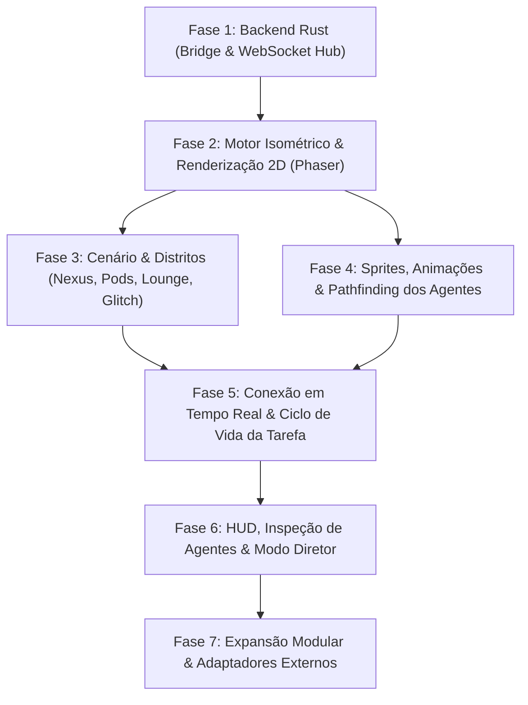

# ROADMAP — The Grid Metropolis: Isometric Multi-Agent Hub

Este documento contém o roadmap completo de desenvolvimento sincronizado com o banco de dados de tarefas no Notion: [The Core — Notion Workspace](https://app.notion.com/p/The-Core-4035f969eb5380928918da31c864d301).

---

## Diagrama Geral de Fases e Dependências

---

## 1. Fase 1: Backend Rust (Bridge & WebSocket Hub)

| ID | Tarefa | Status | Prioridade | Dependências | Descrição |
| :--- | :--- | :--- | :--- | :--- | :--- |
| **T-1.1** | Setup inicial do Crate Rust e dependências | **Done** ✅ | Alta | Nenhuma | Inicializar crate `server` com `Cargo.toml` contendo `axum`, `tokio (full)`, `serde`, `serde_json`, `tower-http` e `tracing`. |
| **T-1.2** | Modelagem de Schemas e Contratos Serde | **Done** ✅ | Alta | T-1.1 | Implementar structs tipadas e enums para `Agent`, `Pod`, `Task`, `WebSocketEvent`, `AgentRole`, `AgentStatus` e `EventTopic`. |
| **T-1.3** | Gerenciamento de Estado do Mundo em Memória | **Done** ✅ | Alta | T-1.2 | Estruturar `WorldState` protegido por `Arc<RwLock>` e canais assíncronos `tokio::sync::broadcast` para distribuição de eventos. |
| **T-1.4** | Endpoint HTTP de Ingestão da Ponte (Bridge Dispatch) | **Done** ✅ | Alta | T-1.3 | Implementar `POST /api/v1/bridge/dispatch` com autenticação Bearer Token, validação de payload e retorno HTTP 202/400/404. |
| **T-1.5** | Endpoint WebSocket para Sincronização em Tempo Real | **Done** ✅ | Alta | T-1.4 | Implementar `GET /ws` usando `axum::extract::ws::WebSocketUpgrade` para streaming bidirecional de eventos JSON. |
| **T-1.6** | Testes de Integração e Script Mock de Disparo | **Done** ✅ | Média | T-1.5 | Criar script de teste automatizado para validar envio de tarefas simuladas e recepção via WebSocket. |

---

## 2. Fase 2: Motor Isométrico & Renderização 2D (Frontend Canvas)

| ID | Tarefa | Status | Prioridade | Dependências | Descrição |
| :--- | :--- | :--- | :--- | :--- | :--- |
| **T-2.1** | Setup do Projeto Frontend (Vite + Svelte + TypeScript) | **Done** ✅ | Alta | Nenhuma | Configurar boilerplate no diretório `client` com Vite, Svelte, TypeScript, Tailwind CSS e base para sobreposição de HUD. |
| **T-2.2** | Inicialização da Engine Isométrica (Phaser.js) | **Done** ✅ | Alta | T-2.1 | Configurar Phaser 3 no modo WebGL com projeção isométrica 2:1 e viewport dimensionável. |
| **T-2.3** | Implementação de Grid Isométrico e Pathfinding A* | **Done** ✅ | Alta | T-2.2 | Configurar EasyStar.js / A* sobre a matriz isométrica para rotas nas passarelas sem colisão com paredes ou abismo. |
| **T-2.4** | Tileset Modular: Passarelas Metálicas e Data Ocean | **Done** ✅ | Alta | T-2.3 | Renderizar malha de passarelas suspensas com bordas iluminadas em ciano/magenta sobre o fundo escuro do Data Ocean. |
| **T-2.5** | Sistema de Z-Sorting e Profundidade em Camadas | **Done** ✅ | Alta | T-2.4 | Garantir ordenação de profundidade automática (z-index) para prédios, pontes e sprites em movimento. |

---

## 3. Fase 3: Cenário & Distritos (Worldbuilding)

| ID | Tarefa | Status | Prioridade | Dependências | Descrição |
| :--- | :--- | :--- | :--- | :--- | :--- |
| **T-3.1** | Construção do Setor The Nexus | **Done** ✅ | Alta | T-2.4 | Modelar e posicionar a plataforma central octogonal com antena parabólica e mesa holográfica translúcida. |
| **T-3.2** | Construção dos Project Pods & Domes | **Done** ✅ | Alta | T-2.4 | Criar estações modulares temáticas com cúpulas, chaminés com partículas de fumaça colorida e telas de status. |
| **T-3.3** | Construção do The Battery Lounge | **Done** ✅ | Média | T-2.4 | Montar bar retrofuturista com letreiros néon verticais, balcão iluminado e banquetas para agentes em repouso. |
| **T-3.4** | Construção do The Glitch Alleys | **Done** ✅ | Média | T-2.4 | Renderizar beco de quarentena com cabos expostos, peças desconectadas, estática de monitor e avisos luminosos. |
| **T-3.5** | Tubulações Luminescentes com Fluxo Bioluminescente | **Done** ✅ | Média | T-3.1, T-3.2 | Implementar dutos de vidro no chão transportando partículas de luz animadas simulando tráfego de dados. |
| **T-3.6** | Arquitetura e Modelagem Volumétrica das Edificações | **Done** ✅ | Alta | T-3.1, T-3.2, T-3.3, T-3.4 | Construir as edificações completas com volumetria isométrica 2:1, paredes de múltiplos pavimentos, janelas com iluminação de dados, telhados detalhados, marquises néon e estruturas arquitetônicas imponentes. |
| **T-3.7** | Integração da Cenografia Viva Mestra e Efeitos Hiperdetalhados | **Done** ✅ | Alta | T-3.6 | Integrar a arte conceitual mestra oficial de The Grid Metropolis como base arquitetônica de alta fidelidade no Phaser, calibrando a malha de pathfinding A*, partículas de fumaça viva nas chaminés, telas holográficas dinâmicas, cabos com pulsos de luz e interatividade dos distritos. |

---

## 4. Fase 4: Agentes, Sprites e Comportamento Espacial

| ID | Tarefa | Status | Prioridade | Dependências | Descrição |
| :--- | :--- | :--- | :--- | :--- | :--- |
| **T-4.1** | Spritesheets e Animações dos Personagens | **Done** ✅ | Alta | T-2.5 | Configurar spritesheets para Hacker, Cientista, Robô de Automação e Drones em 4 direções. |
| **T-4.2** | Máquina de Estados Finita dos Agentes | **Done** ✅ | Alta | T-4.1 | Implementar transições de estado: `IDLE`, `WALKING`, `WORKING`, `MEETING` e `ERROR`. |
| **T-4.3** | Navegação Espacial de Agentes pelas Passarelas | **Done** ✅ | Alta | T-4.2, T-2.3 | Vincular máquina de estados ao pathfinding para caminhar suavemente até destinos com animação direcional. |
| **T-4.4** | Sistema de Balões de Diálogo e Ícones Flutuantes | **Done** ✅ | Alta | T-4.2 | Renderizar balões sincronizados com ícones (engrenagens, lâmpadas, códigos) sobre a cabeça dos agentes. |
| **T-4.5** | Drones Aéreos de Mensageria | **Done** ✅ | Média | T-4.1, T-3.1 | Implementar drones autônomos para transporte aéreo de pacotes de dados entre prédios distantes. |
| **T-4.6** | Remoção de Figuras Estáticas e População Viva Autônoma | **Done** ✅ | Alta | T-4.1, T-4.3, T-3.7 | Limpar as figuras estáticas ilustradas na arte mestra através de inpainting com OpenCV, liberando as passarelas e plataformas, e implementar rotinas autônomas de deambulação e socialização para agentes e NPCs transeuntes vivos com animação direcional e balões dinâmicos. |

---

## 5. Fase 5: Conexão em Tempo Real & Ciclo de Vida da Tarefa

| ID | Tarefa | Prioridade | Dependências | Descrição |
| :--- | :--- | :--- | :--- | :--- |
| **T-5.1** | Sincronização Frontend do Cliente WebSocket | Alta | T-1.5, T-2.1 | Conectar o frontend ao servidor Rust via WebSocket com auto-reconnect e buffer de mensagens. |
| **T-5.2** | Manipulador de Eventos de Despacho e Progresso | **Done** ✅ | Alta | T-5.1, T-4.3 | Tratar `AGENT_SPAWN`, `TASK_ASSIGNED` e `TASK_PROGRESS` acionando movimentação pelas passarelas e animação de trabalho sentado nas estações. |
| **T-5.3** | Mecânica de Pipeline Handover (Delegação) | **Done** ✅ | Alta | T-5.2 | Implementar agente transportando pacote de dados holográfico para encaminhar e delegar tarefas na bancada do colega. |
| **T-5.4** | Mecânica de Colaboração Inter-Casas (Pair/QA) | Média | T-5.2, T-4.4 | Agente visita a estação vizinha disparando diálogo de revisão com balões de conversa. |
| **T-5.5** | Mapeamento de Sucesso (`TASK_COMPLETED`) e Falha (`TASK_ERROR`) | Alta | T-5.2, T-3.4 | Fumaça verde e comemoração em sucesso; iluminação vermelha e escolta ao Glitch Alley em erro. |

---

## 6. Fase 6: Interface HUD & Modo Diretor (Interatividade)

| ID | Tarefa | Prioridade | Dependências | Descrição |
| :--- | :--- | :--- | :--- | :--- |
| **T-6.1** | Gaveta de Chat Contínuo e Inspeção de Agente (Modo Diretor) | **Done** ✅ | Alta | T-4.2, T-2.1 | Exibir status detalhado ao clicar no agente/pod: histórico de chat contínuo com a LLM, arquivos em custódia, métricas de tokens e envio rápido de instruções. |
| **T-6.2** | Mecânica de Drag & Drop de Agentes | Média | T-6.1, T-4.3 | Permitir arrastar agente ocioso do Battery Lounge para um Pod para forçar assistência imediata. |
| **T-6.3** | Visão em Corte (X-Ray Cutaway) dos Pods | Média | T-3.2, T-2.2 | Ocultar o teto/cúpula ao clicar para revelar servidores, consoles e telas internas. |
| **T-6.4** | Controles de Câmera e Navegação | Alta | T-2.2 | Adicionar pan arrastando, zoom na roda do mouse e atalho para centralizar em agentes ou no Nexus. |
| **T-6.5** | Chatbox e Terminal de Comando Integrado (Estilo Habbo / Habblaud) | **Done** ✅ | Alta | T-2.1 | Barra de chat global na base da tela com suporte a @menções (@Rusty, @DrCipher, @All), despacho direto de instruções e balões de resposta/pensamento no mundo. |
| **T-6.6** | Painel de Missões e Backlog Limpo (Estilo Linear / Notion) | **Done** ✅ | Média | T-6.5 | Gaveta lateral minimalista com backlog de tarefas, status (Pendente, Em Andamento, Concluído), filtros por agente e criação rápida de missões. |
| **T-6.7** | Mecânica de Play e Invocação de Cartas (Drag & Drop para o Mundo) | Alta | T-6.5, T-5.2 | Permitir arrastar ou clicar para jogar uma carta da mão diretamente para o Nexus ou Pod de um agente, acionando o despacho de tarefa no backend e a reação visual do personagem. |
| **T-6.8** | Terminal CRT Cyberpunk & Mascote SPARK-01 Animado | **Done** ✅ | Alta | T-6.5 | Implementar interface imersiva de Terminal CRT estilo Cyber-Deck com telemetria (CPU, MEM, NET, Tokens, Latência), chat CLI com curvatura de fósforo verde/magenta e mascote SPARK-01 animado em 4 estados. |
| **T-6.9** | Dashboard de Terminais Multi-Projeto com Sidebar Estilo Habblaud | **Done** ✅ | Alta | T-6.8 | Concentrar a interface em um Dashboard de Terminais CRT. Adicionar sidebar lateral inspirada no Habblaud listando Projetos/Pastas e seus respectivos Droids/Agentes em tempo real, permitindo alternar instantaneamente entre os terminais dedicados de cada projeto. |
| **T-6.10** | Comportamento de Patrulha Autônoma (Wandering) do Mascote SPARK-01 em Idle | **Done** ✅ | Média | T-6.8, T-6.9 | Adicionar movimentação física horizontal (wandering/patrulha) do droid SPARK-01 pela borda do terminal CRT quando em estado IDLE, com inversão de direção (flip horizontal) e paradas ocasionais para descanso. |
| **T-6.11** | Voo Livre 2D (Eixos X/Y) e Balões de Humor Geek do Droid SPARK-01 em Idle | **Done** ✅ | Média | T-6.10 | Permitir que o droid SPARK-01 voe em 2D por todo o espaço do monitor CRT (subir até o topo, descer, planar e patrulhar) e soltar balões ocasionais com piadas e frases geeks/cyberpunk quando em estado idle. |
| **T-6.12** | Ajuste de Balão de Humor e Modo de Repouso/Recarga (Sleep Zzzz) por Inatividade | **Done** ✅ | Média | T-6.11 | Elevar o balão de fala acima da cabeça do droid, aumentar o tempo de leitura (+3s) e adicionar estado de sono profundo com animação Zzzz e recarga de bateria após inatividade. |
| **T-6.13** | Efeitos Sonoros Retrô 8-bit (Web Audio API Synthesizer) | **Done** ✅ | Média | T-6.8, T-6.12 | Sintetizador de áudio Web Audio API integrado sem assets externos pesados: cliques mecânicos de teclado na digitação CLI, zumbido e bips de decolagem do SPARK-01 e fanfarra triunfante em 8-bit ao concluir tarefas. |
| **T-6.14** | Integração Real com Modelos de IA e Streaming no Terminal CRT | **Done** ✅ | Alta | T-6.9, T-1.4 | Conectar a linha de comando do terminal às APIs reais de LLMs (Gemini, Claude, OpenAI) com suporte a streaming de tokens em tempo real, exibição de Chain-of-Thought e execução de ferramentas nos arquivos locais. |
| **T-6.15** | Leitor e Inspetor de Código Retrô no Monitor CRT (Estilo Vim/Nano) | **Done** ✅ | Média | T-6.9, T-6.8 | Aba ou modo de visualização no monitor CRT para inspecionar e navegar pelo código-fonte dos arquivos dos workspaces (ex: Rust, TypeScript, SQL), com syntax highlighting em tons de fósforo verde/âmbar e atalhos de teclado. |
| **T-6.16** | Gerenciador e Criador de Droids Personalizados por Workspace | **Done** ✅ | Média | T-6.9 | Painel e modal para cadastrar e vincular novos droids a qualquer projeto, escolhendo modelo de IA associado, papel especializado (Dev, QA, Security), cor de acento néon e avatar pixel art. |
| **T-6.17** | Pipeline Sequencial Multi-Droid com Handoff Automático (Arquiteto ➔ Coder ➔ Reviewer) | **Done** ✅ | Alta | T-6.9, T-6.8 | Implementar esteira sequencial colaborativa entre múltiplos droids no mesmo projeto (ex: SPARK-01 Arquiteto ➔ Rusty Coder ➔ Vanguard Code Reviewer) com stepper retrô no monitor CRT, handoff automático de contexto entre etapas e troca de turno visual com código e revisão formatados. |
| **T-6.18** | Sistema de Harness e Roster de Droids para Alocação Customizada por Projeto (Estilo Paperclip) | **Done** ✅ | Alta | T-6.17, T-6.9 | Implementar meta-harness estilo Paperclip: Central de Droids (Roster global com persona, skills, modelo LLM e skin pixelada) e assistente de criação/configuração de Projetos permitindo alocar de 1 a N droids específicos por projeto, adaptando o terminal dinamicamente para modo solo ou esteira. |
| **T-6.19** | Foco Reativo de Droid Ativo na Sidebar com Efeito Néon e Simplificação do Header CRT | **Done** ✅ | Alta | T-6.18, T-6.17, T-6.9 | Remover os botões de droids redundantes do sub-header do terminal CRT, mantendo apenas telemetria e progresso percentual. Na sidebar, sincronizar em tempo real o droid em execução na esteira, aplicando efeito de destaque néon pulsante com a cor de acento do droid no card lateral conforme o bastão de execução é transferido. |
| **T-6.20** | Visão Individual e Filtro de Contribuição por Droid no Terminal CRT | **Done** ✅ | Alta | T-6.19, T-6.18, T-6.15 | Permitir selecionar um droid específico no workspace para visualizar sua perspectiva individual: linha do tempo exclusiva de mensagens, raciocínio (Chain-of-Thought), métricas isoladas e arquivos gerados por ele com atalho para o inspetor de código. |
| **T-6.21** | Gabinete Arcade Espacial 80s/90s (Cabinet Bezel & Theme Toggle) no Monitor CRT | **Done** ✅ | Alta | T-6.20, T-6.19, T-6.8 | Implementar moldura temática de gabinete de fliperama arcade espacial (arcade cabinet bezel) com tubos de néon, marquee dinâmico do projeto, botões retro e toggle para alternar entre Modo Arcade Imersivo e Modo Cyber-Deck Limpo. |
| **T-6.22** | Remoção do Modo Arcade e Papel de Parede Temático Cyber-Deck da Plataforma | **Done** ✅ | Alta | T-6.21, T-6.8 | Remover o modo arcade e botão de alternância, fixando a interface no modo deck (cyber-deck CRT), e criar um papel de parede temático futurista/cyberpunk estilizado nas áreas laterais e de fundo da plataforma The Grid Metropolis (Data Ocean, malha isométrica, silhueta urbana, tubulações bioluminescentes e circuitos). |
| **T-6.23** | Provedor Local Codex CLI (Assinatura ChatGPT sem Custo de API) | **Done** ✅ | Alta | T-6.14 | Integração com o binário oficial do Codex CLI (codex.exe) utilizando autenticação local da assinatura ChatGPT para execução de tarefas dos Droids sem custos de API. |
| **T-6.24** | Reset de Dados Simulados e Inicialização do Projeto Real The Notex | **Done** ✅ | Alta | T-6.23 | Remoção de todos os dados fictícios simulados e configuração do projeto real The Notex em C:\Workspace\notex com a tríade oficial de Droids (SPARK-01, Rusty, Vanguard) prontos para execução via Codex CLI. |
| **T-6.25** | Ajuste Ergonômico de Tipografia e Redução de Fontes do Monitor CRT | **Done** ✅ | Alta | T-6.8 | Otimização da densidade de informação e redução do tamanho das fontes tipográficas pixel e mono no monitor CRT, cabeçalho de telemetria, balões de mensagens dos droids e input CLI para maior elegância e legibilidade. |
| **T-6.26** | Telemetria de Ferramentas e Feedback de Execução em Disco do Codex CLI | **Done** ✅ | Alta | T-6.23 | Exibição em tempo real de execução de ferramentas (leitura de arquivos, comandos de shell e gravação em disco) do Codex CLI no terminal CRT para eliminar períodos de silêncio e exibir badges interativos dos arquivos gerados. |
| **T-6.27** | Variantes de Modelo do Codex (Sol/Terra/Luna), Níveis de Raciocínio e Memória Persistente de Thread por Projeto | **Done** ✅ | Alta | T-6.26 | Configuração de variantes de modelo Codex (GPT-6.1 Sol, Astra, Terra, Luna, GPT-5.6) e níveis de raciocínio (Light, Medium, High, Extra High) por Droid no Harness, além de persistência contínua de memória e contexto conversacional por projeto via thread_id e codex exec resume. |
| **T-6.28** | Persistência Local com SQLite no Backend Rust (Projetos, Squad de Droids, Mensagens e Sessões) | **Done** ✅ | Alta | T-6.27 | Implementação de persistência relacional com SQLite no backend Rust e sincronização com o client Svelte 5 para persistir projetos, droids, configurações de modelo e histórico conversacional após F5. |
| **T-6.29** | Exclusão de Projetos e Tarefas, Correção de Persistência de Sessão (Active Workspace e Thread ID) | **Done** ✅ | Alta | T-6.28 | Implementação da funcionalidade de exclusão de projetos e tarefas na UI e backend SQLite, além de garantir a persistência da sessão ativa e threadId entre recarregamentos F5. |
| **T-6.30** | [Repaginação Cyber-Deck: legibilidade, tipografia e hierarquia visual](https://app.notion.com/p/4085f969eb53817fb708ea4113733738) | **Done** ✅ | Alta | T-6.19, T-6.22, T-6.25 | Renovar terminal, sidebar e modais com fontes legíveis, mensagens em 16 px, metadados em 12 px, foco de teclado, movimento reduzido, moldura discreta e telemetria expansível; preservar cenário e SPARK em faixa dedicada. Validado: npm run check (0 erros/avisos), npm run build e revisão visual desktop/tablet/celular; bridge offline, sem execução de IA. |
| **T-6.31** | Persistência por Projeto de Histórico de Mensagens e Exclusão Definitiva | **Done** ✅ | Alta | T-6.28, T-6.29 | Persistir mensagens novas e respostas em streaming no SQLite por `project_id`, retomar o `threadId` do Codex ao retornar ao workspace e só remover projetos/mensagens da UI após confirmação do backend. Validado: npm run check, npm run build e cargo test. |
| **T-6.32** | Renderização Markdown no Terminal CRT | **Done** ✅ | Alta | T-6.30, T-6.31 | Renderizar títulos, listas, ênfases, links, citações, tabelas e blocos de código com hierarquia visual cyberpunk, escapando conteúdo antes do `{@html}` e suportando Markdown parcial durante o streaming. Validado: npm run check e npm run build. |
| **T-6.33** | Code Highlight por Linguagem e Abertura de Artefatos Reais | **Done** ✅ | Alta | T-6.31, T-6.32 | Destacar blocos Rust, TypeScript/JavaScript, Python, JSON, SQL, Bash, HTML, CSS e Markdown; abrir artefatos no workspace real via API segura, com proteção contra traversal, limite de tamanho e estado explícito para arquivo indisponível. Validado: npm run check, npm run build e cargo test (13 testes, incluindo leitura/proteção de artefato). |

---

## 7. Fase 7: Expansão Modular & Adaptadores Externos

| ID | Tarefa | Prioridade | Dependências | Descrição |
| :--- | :--- | :--- | :--- | :--- |
| **T-7.1** | Animação de Construção Modular Dinâmica | Média | T-3.2 | Grua/plataforma desce do topo para construir novos Pods na borda quando novos projetos chegam. |
| **T-7.2** | Adaptadores de Webhooks (GitHub, Claude, Codex) | Média | T-1.4 | Normalizadores de payloads externos para o formato padrão do dispatch da ponte. |
| **T-7.3** | Benchmarking, Otimização WebGL e Polimento Final | Alta | T-5.5, T-6.4 | Otimizar partículas, draw calls e z-sorting para manter 60 FPS estáveis com 50+ agentes ativos. |
