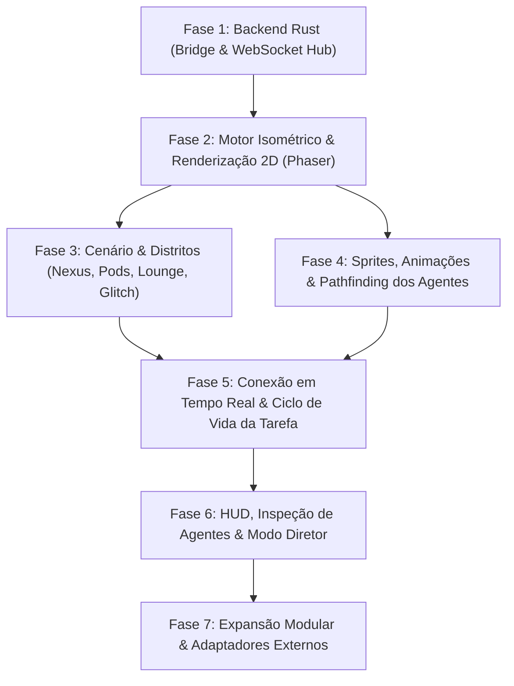

# ROADMAP — The Grid Metropolis: Isometric Multi-Agent Hub

Este documento contém o roadmap completo de desenvolvimento sincronizado com o banco de dados de tarefas no Notion: [The Core — Notion Workspace](https://app.notion.com/p/The-Core-4035f969eb5380928918da31c864d301).

---

## Diagrama Geral de Fases e Dependências

---

## 1. Fase 1: Backend Rust (Bridge & WebSocket Hub)

| ID | Tarefa | Status | Prioridade | Dependências | Descrição |
| :--- | :--- | :--- | :--- | :--- | :--- |
| **T-1.1** | Setup inicial do Crate Rust e dependências | **Done** ✅ | Alta | Nenhuma | Inicializar crate `server` com `Cargo.toml` contendo `axum`, `tokio (full)`, `serde`, `serde_json`, `tower-http` e `tracing`. |
| **T-1.2** | Modelagem de Schemas e Contratos Serde | **Done** ✅ | Alta | T-1.1 | Implementar structs tipadas e enums para `Agent`, `Pod`, `Task`, `WebSocketEvent`, `AgentRole`, `AgentStatus` e `EventTopic`. |
| **T-1.3** | Gerenciamento de Estado do Mundo em Memória | **Done** ✅ | Alta | T-1.2 | Estruturar `WorldState` protegido por `Arc<RwLock>` e canais assíncronos `tokio::sync::broadcast` para distribuição de eventos. |
| **T-1.4** | Endpoint HTTP de Ingestão da Ponte (Bridge Dispatch) | **Done** ✅ | Alta | T-1.3 | Implementar `POST /api/v1/bridge/dispatch` com autenticação Bearer Token, validação de payload e retorno HTTP 202/400/404. |
| **T-1.5** | Endpoint WebSocket para Sincronização em Tempo Real | **Done** ✅ | Alta | T-1.4 | Implementar `GET /ws` usando `axum::extract::ws::WebSocketUpgrade` para streaming bidirecional de eventos JSON. |
| **T-1.6** | Testes de Integração e Script Mock de Disparo | **Done** ✅ | Média | T-1.5 | Criar script de teste automatizado para validar envio de tarefas simuladas e recepção via WebSocket. |

---

## 2. Fase 2: Motor Isométrico & Renderização 2D (Frontend Canvas)

| ID | Tarefa | Status | Prioridade | Dependências | Descrição |
| :--- | :--- | :--- | :--- | :--- | :--- |
| **T-2.1** | Setup do Projeto Frontend (Vite + Svelte + TypeScript) | **Done** ✅ | Alta | Nenhuma | Configurar boilerplate no diretório `client` com Vite, Svelte, TypeScript, Tailwind CSS e base para sobreposição de HUD. |
| **T-2.2** | Inicialização da Engine Isométrica (Phaser.js) | **Done** ✅ | Alta | T-2.1 | Configurar Phaser 3 no modo WebGL com projeção isométrica 2:1 e viewport dimensionável. |
| **T-2.3** | Implementação de Grid Isométrico e Pathfinding A* | Backlog | Alta | T-2.2 | Configurar EasyStar.js / A* sobre a matriz isométrica para rotas nas passarelas sem colisão com paredes ou abismo. |
| **T-2.4** | Tileset Modular: Passarelas Metálicas e Data Ocean | Backlog | Alta | T-2.3 | Renderizar malha de passarelas suspensas com bordas iluminadas em ciano/magenta sobre o fundo escuro do Data Ocean. |
| **T-2.5** | Sistema de Z-Sorting e Profundidade em Camadas | Backlog | Alta | T-2.4 | Garantir ordenação de profundidade automática (z-index) para prédios, pontes e sprites em movimento. |

---

## 3. Fase 3: Cenário & Distritos (Worldbuilding)

| ID | Tarefa | Prioridade | Dependências | Descrição |
| :--- | :--- | :--- | :--- | :--- |
| **T-3.1** | Construção do Setor The Nexus | Alta | T-2.4 | Modelar e posicionar a plataforma central octogonal com antena parabólica e mesa holográfica translúcida. |
| **T-3.2** | Construção dos Project Pods & Domes | Alta | T-2.4 | Criar estações modulares temáticas com cúpulas, chaminés com partículas de fumaça colorida e telas de status. |
| **T-3.3** | Construção do The Battery Lounge | Média | T-2.4 | Montar bar retrofuturista com letreiros néon verticais, balcão iluminado e banquetas para agentes em repouso. |
| **T-3.4** | Construção do The Glitch Alleys | Média | T-2.4 | Renderizar beco de quarentena com cabos expostos, peças desconectadas, estática de monitor e avisos luminosos. |
| **T-3.5** | Tubulações Luminescentes com Fluxo Bioluminescente | Média | T-3.1, T-3.2 | Implementar dutos de vidro no chão transportando partículas de luz animadas simulando tráfego de dados. |

---

## 4. Fase 4: Agentes, Sprites e Comportamento Espacial

| ID | Tarefa | Prioridade | Dependências | Descrição |
| :--- | :--- | :--- | :--- | :--- |
| **T-4.1** | Spritesheets e Animações dos Personagens | Alta | T-2.5 | Configurar spritesheets para Hacker, Cientista, Robô de Automação e Drones em 4 direções. |
| **T-4.2** | Máquina de Estados Finita dos Agentes | Alta | T-4.1 | Implementar transições de estado: `IDLE`, `WALKING`, `WORKING`, `MEETING` e `ERROR`. |
| **T-4.3** | Navegação Espacial de Agentes pelas Passarelas | Alta | T-4.2, T-2.3 | Vincular máquina de estados ao pathfinding para caminhar suavemente até destinos com animação direcional. |
| **T-4.4** | Sistema de Balões de Diálogo e Ícones Flutuantes | Alta | T-4.2 | Renderizar balões sincronizados com ícones (engrenagens, lâmpadas, códigos) sobre a cabeça dos agentes. |
| **T-4.5** | Drones Aéreos de Mensageria | Média | T-4.1, T-3.1 | Implementar drones autônomos para transporte aéreo de pacotes de dados entre prédios distantes. |

---

## 5. Fase 5: Conexão em Tempo Real & Ciclo de Vida da Tarefa

| ID | Tarefa | Prioridade | Dependências | Descrição |
| :--- | :--- | :--- | :--- | :--- |
| **T-5.1** | Sincronização Frontend do Cliente WebSocket | Alta | T-1.5, T-2.1 | Conectar o frontend ao servidor Rust via WebSocket com auto-reconnect e buffer de mensagens. |
| **T-5.2** | Manipulador de Eventos de Despacho e Progresso | Alta | T-5.1, T-4.3 | Tratar `AGENT_SPAWN`, `TASK_ASSIGNED` e `TASK_PROGRESS` acionando movimentação e efeitos nas estações. |
| **T-5.3** | Mecânica de Pipeline Handover (Delegação) | Alta | T-5.2 | Implementar sprite carregando maleta translúcida/holograma para entrega na estação do colega. |
| **T-5.4** | Mecânica de Colaboração Inter-Casas (Pair/QA) | Média | T-5.2, T-4.4 | Agente visita a estação vizinha disparando diálogo de revisão com balões de conversa. |
| **T-5.5** | Mapeamento de Sucesso (`TASK_COMPLETED`) e Falha (`TASK_ERROR`) | Alta | T-5.2, T-3.4 | Fumaça verde e comemoração em sucesso; iluminação vermelha e escolta ao Glitch Alley em erro. |

---

## 6. Fase 6: Interface HUD & Modo Diretor (Interatividade)

| ID | Tarefa | Prioridade | Dependências | Descrição |
| :--- | :--- | :--- | :--- | :--- |
| **T-6.1** | Modal/Gaveta de Inspeção do Agente (Modo Diretor) | Alta | T-4.2, T-2.1 | Exibir status detalhado ao clicar: Scratchpad/LLM Reasoning, tokens consumidos, uptime e arquivos. |
| **T-6.2** | Mecânica de Drag & Drop de Agentes | Média | T-6.1, T-4.3 | Permitir arrastar agente ocioso do Battery Lounge para um Pod para forçar assistência imediata. |
| **T-6.3** | Visão em Corte (X-Ray Cutaway) dos Pods | Média | T-3.2, T-2.2 | Ocultar o teto/cúpula ao clicar para revelar servidores, consoles e telas internas. |
| **T-6.4** | Controles de Câmera e Navegação | Alta | T-2.2 | Adicionar pan arrastando, zoom na roda do mouse e atalho para centralizar em agentes ou no Nexus. |

---

## 7. Fase 7: Expansão Modular & Adaptadores Externos

| ID | Tarefa | Prioridade | Dependências | Descrição |
| :--- | :--- | :--- | :--- | :--- |
| **T-7.1** | Animação de Construção Modular Dinâmica | Média | T-3.2 | Grua/plataforma desce do topo para construir novos Pods na borda quando novos projetos chegam. |
| **T-7.2** | Adaptadores de Webhooks (GitHub, Claude, Codex) | Média | T-1.4 | Normalizadores de payloads externos para o formato padrão do dispatch da ponte. |
| **T-7.3** | Benchmarking, Otimização WebGL e Polimento Final | Alta | T-5.5, T-6.4 | Otimizar partículas, draw calls e z-sorting para manter 60 FPS estáveis com 50+ agentes ativos. |
