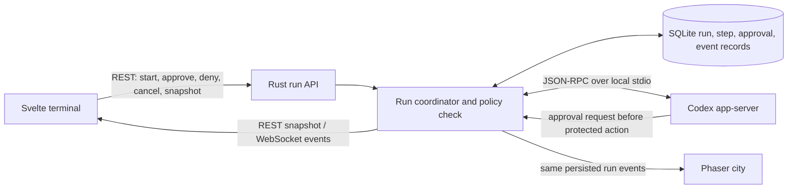

# The Grid Metropolis Harness — Verifiable Droid Runs

* **Author:** Project owner and Codex design draft
* **Status:** Draft
* **Date:** 2026-10-29

## Overview

The Harness should let a user give a task to a selected project, watch the droids carry it through real execution and verification, and inspect what changed and why the run stopped. The existing Architect, Coder, and Reviewer roles provide the starting workflow. A configured test command and one bounded repair pass add evidence beyond model-written claims. The city reflects the same run state so its activity remains truthful.

## The Problem

The current Harness has a terminal, project conversations, a sequential multi-droid pipeline, a Codex streaming endpoint, and a separate Phaser city. These pieces do not yet provide one trustworthy execution record. The pipeline can continue after a stage error and can report completion without independent test evidence. City agents can wander independently of actual work, and the Codex endpoint bypasses sandbox and approval controls while accepting a caller-provided working directory. As a result, users cannot reliably tell what ran, what was authorized, whether tests passed, or whether a visible droid action represents real work.

The design connects the workflow to a server-owned run record, enforces the project and droid access rules before operations execute, records machine-verifiable test outcomes, and drives the terminal and city from those same events. If a required permission is denied, the droid may try up to three distinct alternatives within existing grants. If none works, it can make one specific new request; if that grant is denied, the run stops as blocked while preserving prior work.

## Goals

* Let the user start a real run in a selected project and inspect its current stage, responsible droid, operations, and outcome.
* Reuse the sequential Architect → Coder → Reviewer flow while making stage failures truthful and preventing false success.
* Enforce project-level access limits and narrower per-droid permissions in the backend, including explicit access to any named reference projects.
* Pause before an operation that lacks permission. Keep the pending request across Harness restarts without keeping a process active, and resume only after the specific operation is authorized.
* After a denied action, allow up to three distinct alternatives using already granted access, followed by at most one specific permission request. If that request is denied, stop as blocked.
* Run an explicitly configured verification command, record its exit status and bounded output, and allow one repair pass before reporting the final result.
* Produce a factual run record and summary from captured operations, changed files, test evidence, and review findings.
* Show task-related droid activity in the terminal and city from the same run events. Label ambient or simulated activity so it cannot be mistaken for live execution.
* Preserve older project conversations and thread records while introducing versioned run state.

## Non-Goals

* A general-purpose workflow engine, parallel autonomous agents, or an open-ended repair loop.
* Unrestricted access to the host, arbitrary caller-supplied paths, or access to unlisted reference projects.
* Remembered permissions in the first safe milestone. They may be added after task-scoped grants are enforced, audited, and revocable.
* A mandatory documenter droid for every task; the first version can generate a factual summary from run evidence.
* Building a full city simulation, social behavior system, or elaborate animations before the real run flow is trustworthy.
* Adding Redis, distributed queues, or a separate telemetry platform for the initial desktop workflow.

## Open Questions

* Can a pending app-server approval be reconstructed safely after the app-server process exits, the Harness closes, and the Codex thread is resumed? A prototype must answer this before real runs are enabled.
* Which project script formats are supported for verification preset discovery, and how should the setup UI behave when it finds no script or several plausible scripts?
* Which local callers rely on the current `/api/v1/codex/stream` request/auth behavior, beyond the Svelte client in this repository?

## Technical Plan (Architecture)

### Decision 1: Codex execution interface — selected

The owner selected **Option A: Codex app-server over local stdio**. The Rust backend will start the app-server as a child process and exchange JSON-RPC messages over stdin/stdout. The app-server will remain local to the sidecar; do not expose its TCP WebSocket listener. The Codex documentation describes stdio as the default transport and marks the TCP WebSocket transport experimental and unsupported for production. [Codex App Server](https://learn.chatgpt.com/docs/app-server)

The Rust run coordinator remains the authority for project identity, droid policy, durable run status, and verification outcomes. It checks every approval request against the selected project ceiling and droid profile before responding to app-server. Use only sandboxed operations; do not expose app-server methods that execute shell commands outside the sandbox. Start with the Codex-backed execution path; other configured model providers remain available for conversation but are not treated as project-changing runners until they have an equivalent controlled execution adapter.

The existing `codex exec --json` approach is retained as an alternative for fixed-policy batch runs, but its non-interactive mode does not provide the required in-app approval pause when an operation cannot surface a fresh approval. A Harness-owned model/tool loop is also an alternative, but it would mean maintaining a second agent runtime. Neither option is selected.

The approval record must survive closing and reopening the Harness even though an app-server request is tied to an active thread/turn. Before implementation, verify how the adapter reconstructs or resumes a blocked operation after process restart. It must never replay a command or file change whose completion is uncertain. See [Codex App Server approvals](https://learn.chatgpt.com/docs/app-server#approvals) and [non-interactive Codex mode](https://learn.chatgpt.com/docs/non-interactive-mode).

The current backend starts `codex exec --json` as a child process and streams JSON Lines through SSE. It disables the Codex sandbox and approval prompts. This run path cannot deliver the required permission boundary or a trustworthy pause until that behavior changes.

The alternatives considered for this decision are:

#### Option A: Codex app-server over local stdio — selected

The Rust backend starts `codex app-server` as a child process and speaks its JSON-RPC protocol over stdin/stdout. The Harness maps its approval requests to durable run records and the permission UI, then responds to Codex. App-server supports streamed thread/turn events, approval requests, and thread resume. Use local stdio rather than its TCP WebSocket listener, which the current documentation marks experimental and unsupported for production use. See [Codex App Server](https://learn.chatgpt.com/docs/app-server).

* **Trade-off:** Provides the closest supported integration for a custom client that must receive and answer Codex approval requests. It adds a long-lived protocol adapter and depends more directly on Codex app-server event/schema compatibility.
* **Acceptance condition:** Before enabling task execution, a prototype must prove that a pending operation can be safely resumed after the Harness and app-server restart without repeating prior file changes or commands.

#### Option B: Keep non-interactive `codex exec --json`

The backend continues to start one Codex CLI process per run step with explicit sandbox and approval settings. The run service records an approval-required failure as pending; after the user grants access, it resumes from a persisted checkpoint in a new CLI turn. `codex exec` is documented for automation with pre-set sandbox and approval settings and supports JSONL progress and session resume. If an action requiring new approval cannot surface an interactive request, the action fails back to the caller rather than waiting in the Harness. See [Non-interactive mode](https://learn.chatgpt.com/docs/non-interactive-mode) and [Agent approvals and security](https://learn.chatgpt.com/docs/agent-approvals-security).

* **Trade-off:** Reuses the current process and JSONL streaming shape, with less protocol integration than app-server. The Harness must own pause, checkpoint, and resume behavior rather than relying on an in-flight Codex approval.
* **Reason not selected:** It lacks the in-app approval pause required for this workflow unless the Harness builds its own checkpoint-and-restart mechanism around CLI failures; that would leave the core approval boundary outside Codex’s interactive protocol.

#### Option C: Harness-owned tool execution loop

The Harness asks the selected model for structured tool calls and runs each file, shell, test, or web operation through its own server-side tool adapter. The adapter checks project and droid policy before each operation and persists permission pauses itself.

* **Trade-off:** Gives the Harness direct control over permission scopes and pause/resume behavior across providers. It requires building and maintaining the agent loop, tool protocol, sandbox boundary, and provider adapters rather than relying on Codex’s execution harness.
* **Failure condition:** Do not select it if the supported tools cannot cover the actual project work or if maintaining a second agent runtime costs more than the control it adds.

### Decision 2: Live run events and reconnect recovery

The owner selected **Option A: existing WebSocket for run events, REST for commands and snapshots**.

The city and terminal need the same run updates, while a closed or disconnected client must recover without losing an approval request or terminal result. The backend will persist run state and event sequence numbers in SQLite; the client can then fetch the current run snapshot after reconnect. Choose how live updates reach the connected client:

#### Option A: Existing WebSocket for run events, REST for commands and snapshots

Keep REST calls for starting, approving, denying, and cancelling runs. Publish correlated run events over the existing `/ws` connection. On reconnect, fetch the persisted run snapshot, then consume new events.

* **Trade-off:** Uses the current channel used by the city and keeps client commands request/response. The WebSocket protocol needs a clear event cursor and snapshot reconciliation rule.
* **Failure condition:** Do not select it if the existing WebSocket cannot support durable event IDs or if reconnect can leave a gap that the REST snapshot cannot reconcile.

#### Option B: SSE stream per run, REST for commands and snapshots

Keep REST for run commands and state queries, and provide a run-specific SSE stream for ordered lifecycle updates. The client reconnects with a last-seen event ID, then fetches a snapshot if the event history has expired.

* **Trade-off:** Fits the unidirectional run event flow and existing SSE experience. It creates a second live-update path alongside the city WebSocket.
* **Failure condition:** Do not select it if the client needs bidirectional run control on the stream or if managing two reconnect/event paths causes inconsistent UI state.

#### Option C: One bidirectional WebSocket for run commands and events

Send run commands and receive run events over a run-aware WebSocket protocol, with a separate REST endpoint for initial snapshots and recovery.

* **Trade-off:** One live connection can carry commands and events together. The protocol must define request IDs, acknowledgements, authorization, reconnect replay, and idempotency for every command.
* **Failure condition:** Do not select it if lost acknowledgements can cause duplicate grants, task starts, or cancellations, or if the extra protocol complexity is not justified by the desktop client.

### Selected event flow

Use the existing WebSocket only for server-to-client run lifecycle events. Use authenticated REST requests for starting a run, responding to a permission request, cancelling a run, and fetching the current snapshot. Persist events before publishing them and include a monotonically increasing sequence number per run. On reconnect, the client fetches the run snapshot and its last event sequence; the server returns or republishes later events so the terminal and Phaser view can converge on the same state.

Every run event carries `run_id`, `project_id`, `droid_id` when relevant, `step_id`, `attempt`, `sequence`, `timestamp`, and a typed payload. The run coordinator—not the UI or game scene—owns transitions. The Svelte terminal and Phaser scene are projections of the same stored state. Animation failure cannot change a run result.

The Rust backend resolves `project_id` to the configured canonical root. Clients cannot select a filesystem path by sending `working_dir`. All run-control routes require local caller authentication and validate that a run and approval request belong to the referenced project. Permission responses use an approval-request ID and an idempotency key so retrying a lost HTTP response cannot grant or execute the operation twice.

### Decision 3: Run API resource paths

The owner selected **Option B: preserve the SSE endpoint and add a durable-run resource**. Keep `POST /api/v1/codex/stream` as an SSE contract for existing callers. Start workflow runs with `POST /api/v1/projects/{project_id}/runs`, return `202 Accepted` with a `run_id`, and use the selected REST + WebSocket design for run actions and updates. The Svelte client moves to the durable-run resource for orchestrated work.

Preserving the SSE response format does not mean preserving the current unrestricted behavior. All execution paths, including the legacy SSE route, must resolve registered project identity on the server and enforce sandbox, authentication, and capability policy. Any request or auth change that breaks existing callers must be documented in the OpenAPI contract and have a migration path.

No OpenAPI or Postman contract currently exists in the repository. Create one OpenAPI contract as the source of truth for the new durable-run API and any changed legacy SSE requirements before implementation. Keep the existing stream route’s response format unless a separate versioned change is approved.

The durable-run API will use these resource operations:

* `POST /api/v1/projects/{project_id}/runs` creates a run and returns `202 Accepted`, its stable `run_id`, initial state, and a `Location` for the run resource. A required idempotency key prevents duplicate run creation on client retry.
* `GET /api/v1/runs/{run_id}` returns the current durable snapshot, including project, stage, droid, pending permission request, evidence, and terminal outcome. The server verifies the caller’s project access.
* `GET /api/v1/runs/{run_id}/events?after_sequence=<n>` replays persisted events after the client’s last sequence number.
* `POST /api/v1/runs/{run_id}/permission-requests/{request_id}/decisions` records a one-time grant or denial. The server verifies the request is still pending and applies a repeated decision idempotently.
* `POST /api/v1/runs/{run_id}/cancellations` requests cancellation and returns the resulting or pending state.
* The existing WebSocket publishes persisted run events; reconnect recovery uses the run snapshot and sequence cursor, not an SSE response body.

Run creation accepts a task prompt and optional title/context references, but no caller-supplied filesystem path, arbitrary shell command, or unregistered project/droid ID. The project’s selected verification preset and configured role sequence are resolved from server-owned settings. Run-control and Codex execution routes require local authentication. Use one stable JSON error envelope with machine-readable `code`, human-readable `message`, and a request ID; return distinct status codes for invalid input, unauthenticated, forbidden, unknown project/run, conflicting run state, and unavailable Codex runtime.

### Decision 4: Durable run record layout

The owner selected **Option A: normalized run, step, permission, and event tables**. Additive SQLite migrations create the tables without rewriting project conversations or droid records. Each state change that affects the run snapshot and event history commits in one transaction; publish the WebSocket event only after commit.

The backend already uses SQLite for projects and messages. Both designs below add run persistence to that database; neither holds a database lock while waiting for Codex or a verification command. The run record and its event must commit before the event is published to the WebSocket.

#### Option A: Normalized run, step, permission, and event tables

Add relational tables for `runs`, `run_steps`, `run_permission_requests`, and `run_events`, with foreign keys and a unique `(run_id, sequence)` event cursor. Store flexible provider and event details in JSON payload columns while keeping IDs, state, timestamps, and decisions in typed columns.

* **Trade-off:** Makes state transitions, pending approvals, and audit queries explicit and constrained. Requires more additive schema work and transaction logic.
* **Failure condition:** Do not select it if the run data is too transient to justify relational history or if the project cannot support safe additive schema changes.

#### Option B: Run snapshot plus append-only event table

Add a `runs` table with a JSON snapshot of current state and a separate append-only `run_events` table with sequence IDs. Each state transition updates the snapshot and appends its event in one transaction; step and approval details live inside the snapshot and event payloads.

* **Trade-off:** Keeps the schema smaller and supports reconnect replay while allowing the run shape to evolve. Application code must validate nested state and guard snapshot/event consistency.
* **Failure condition:** Do not select it if support, audit, or history views need frequent queries across individual steps or permission requests that JSON snapshots cannot answer safely and clearly.

### Decision 5: Project verification command configuration

The owner selected **Option A: select from detected project scripts and presets**. Project setup shows supported script names and stores a stable preset ID. The backend resolves the preset to a server-owned argument vector; the model cannot change or substitute it during a run.

The run needs a real command to verify changes. The command must be selected by project configuration, run under the project's sandbox and resource limits, and recorded with its exit status and bounded output. The model must not silently invent or substitute a verification command.

#### Option A: Select from detected project scripts and presets

The Harness detects supported project scripts (such as package scripts or Cargo test/build targets), shows the available names, and stores the selected command as a stable preset ID with a server-owned argument vector.

* **Trade-off:** The UI can present clear named choices and the server can control the exact executable and arguments. It will not cover every repository's custom verification workflow.
* **Failure condition:** Do not select it if supported project types or custom task-specific verification cannot be represented by the preset catalog.

#### Option B: Let the project owner configure an exact argument vector

The owner stores the executable and arguments for the project in settings. The server runs that exact array without shell interpolation, within the selected project root and sandbox. The agent may recommend a change, but cannot alter the configured command during a run.

* **Trade-off:** Supports custom verification while keeping command choice outside model control. Project setup requires the owner to know and maintain the correct command.
* **Failure condition:** Do not select it if supported platforms cannot execute or constrain the stored command safely, or if users need the model to select verification steps dynamically.

### Run coordinator boundaries and workflow

The Rust server owns the run state machine and is the only component allowed to make execution or permission decisions. Svelte requests a new run and renders persisted state. The Rust coordinator writes a run record, creates the Codex app-server thread, and advances the Architect → Coder → configured verification → at-most-one repair → Reviewer sequence. Every stage records a typed result; a failed stage prevents downstream success. A deterministic summary is generated from recorded operations and outcomes. A separate Documenter droid is out of scope for the first milestone.

The run state machine includes `QUEUED`, `PLANNING`, `EXECUTING`, `VERIFYING`, `REPAIRING`, `REVIEWING`, `WAITING_FOR_PERMISSION`, `SUCCEEDED`, `FAILED`, `BLOCKED`, and `CANCELLED`. Only a recorded verification success and all required stages can produce `SUCCEEDED`. After a permission denial, the droid may try up to three distinct alternatives using current grants; after that, it can make one specific additional permission request. If the user denies that request, the run becomes `BLOCKED`. Each attempt is recorded; the run never repeats an uncertain mutating action after restart.

The app-server adapter handles Codex threads, turns, streamed items, and approval requests over local stdio. The Rust policy service resolves the project root and droid profile from server-owned IDs. Before answering an app-server approval request, it checks the requested command, filesystem path, and network scope against the project ceiling and droid subset. The backend persists the pending action, then the client shows its exact target and consequence. A grant applies only to that displayed action. A denial returns control to the workflow so the droid can attempt its bounded alternative path.

Map the capability profile to Codex sandbox settings per turn: the project root is the working directory; droid-allowed write roots become `writableRoots`; explicitly selected reference projects are added only as restricted read-only roots; network is enabled only when both project and droid policy allow it. Keep web-search access separate from shell-command network access. App-server documents per-turn sandbox overrides, restricted read roots, and `command/exec` under the server sandbox. Do not expose `process/spawn`, which the current documentation marks experimental and outside the sandbox. See [Codex App Server sandbox policy](https://learn.chatgpt.com/docs/app-server#sandbox-read-access-readonlyaccess) and [command execution](https://learn.chatgpt.com/docs/app-server#command-execution).

Verification uses the selected project preset and app-server `command/exec` with a fixed argument vector, canonical project root, explicit timeout, and output limits. Persist command identity, exit code, duration, and bounded stdout/stderr. If verification fails, send the recorded evidence to the Coder for one repair attempt, then rerun the same preset once. No model-generated shell string is accepted as the verification command.

### Run persistence and event contract

The normalized SQLite design uses additive tables:

* `runs`: run ID, project ID, status, selected droid IDs, idempotency key, Codex thread reference, timestamps, and terminal outcome.
* `run_steps`: run ID, stable step ID and order, droid ID, stage, attempt number, status, start/end time, and structured result reference.
* `run_permission_requests`: request ID, run/project/droid IDs, requested action and resource, requested capability, pending/granted/denied status, and decision timestamps.
* `run_events`: run ID, unique sequence number, typed event name, timestamp, and bounded, redacted JSON payload for WebSocket replay.

Create the appropriate foreign keys and indexes; project deletion must not silently erase an active run or its audit history. Store payloads without credentials or private model reasoning, and bound and redact captured command output before persistence. A pending approval remains in SQLite after the app and child processes close. After restart, the app-server adapter reconciles the saved thread with the persisted operation. If it cannot prove the operation did not already execute, mark the run `BLOCKED` for recovery instead of replaying it.

The run API source of truth is one OpenAPI file at `server/openapi.yaml`. It defines the durable-run start, snapshot, permission-decision, cancellation, event-replay, execution-settings, and verification-preset contracts, including auth, idempotency, stable errors, and success/failure examples. Keep the legacy `/api/v1/codex/stream` SSE response envelope for existing callers, but resolve `working_dir` only to an already registered canonical project; reject unregistered paths and enforce the same server-side limits. The response shape is preserved; authentication and path-validation changes can still require client migration and must be called out as contract changes. The new Svelte workflow uses the durable-run resource and does not use the legacy stream endpoint for orchestration.

Persist lifecycle events before broadcasting them over `/ws`. Each event has a per-run increasing sequence number and includes run, project, step, droid, attempt, and timestamp fields. The client starts from `GET /api/v1/runs/{run_id}` and replays `GET /api/v1/runs/{run_id}/events?after_sequence=<n>` after reconnect, then follows the WebSocket. Svelte stores and Phaser both render this canonical event stream. Ambient or simulated activity is labeled separately; animation errors do not affect task status.

## Alternatives Considered

### One droid with one verification command

* **Pros:** Fewer handoffs and state transitions make a safe first run easier to isolate.
* **Cons:** It omits the Architect → Coder → Reviewer handoffs already present in the Harness.
* **Reason for rejection:** The first workflow will reuse those three roles while moving authority and truthful outcomes into the server. Keep a one-droid path as a fallback if the role flow cannot be made safe.

### A configurable workflow engine with parallel agents and open-ended retries

* **Pros:** Users could rearrange steps and run independent agents at the same time.
* **Cons:** Parallel work, arbitrary transitions, and retry policies multiply partial-failure, permission, cost, and recovery cases.
* **Reason for rejection:** The Harness has not yet proved one safe, resumable run. Keep the first workflow sequential with one repair pass and at most three distinct alternatives after a denied action.

### A dedicated Documenter droid for every run

* **Pros:** It could produce tailored prose or project-specific documents.
* **Cons:** It adds a model call and can state outcomes that were not supported by run evidence.
* **Reason for rejection:** A deterministic summary from changed files, exit codes, and review findings is more directly verifiable. Add a Documenter only when a specific generated artifact requires it.

### Remembered grants in the first safe milestone

* **Pros:** A user would not need to approve the same droid and capability repeatedly.
* **Cons:** Persistent grants need strict project and capability scope, durable history, revocation, and proof that every execution path enforces them.
* **Reason for rejection:** Start with task-scoped grants and prove server enforcement first. Add remembered grants later with explicit scope and revocation.

### Redis, a job queue, or a new telemetry platform

* **Pros:** These services can help distribute work across processes or machines and can support larger deployments.
* **Cons:** They add deployment, operations, and failure-recovery work to a local desktop workflow.
* **Reason for rejection:** SQLite, Rust tracing, the existing WebSocket, and persisted run events cover the first milestone. Add infrastructure only when measured usage requires it.

### Non-interactive `codex exec` as the main run interface

* **Pros:** It reuses the current CLI process and JSONL stream and fits scripted automation.
* **Cons:** The Harness needs an in-app permission pause at the exact requested operation; non-interactive runs may fail when a fresh approval cannot be surfaced.
* **Reason for rejection:** Codex app-server over local stdio provides a client protocol for streamed events and approval decisions. Its restart recovery still requires a prototype before real runs are enabled.

### A Harness-owned model and tool execution loop

* **Pros:** The Harness would control each tool call and could apply the same permission model across more providers.
* **Cons:** The project would need to build and maintain its own agent loop, provider adapters, tool protocol, execution boundary, and recovery behavior.
* **Reason for rejection:** The selected app-server path reuses Codex’s execution and approval protocol for the first real runner. Other model providers remain conversation-only until a controlled execution adapter is justified.

### Per-run SSE instead of the existing WebSocket plus REST

* **Pros:** A run-specific stream is simple for one-way progress and can use event IDs for reconnect.
* **Cons:** The city already uses a WebSocket, so two live event systems would need separate reconnect and consistency rules.
* **Reason for rejection:** Keep the existing WebSocket for persisted run events and REST for actions, snapshots, and replay. Preserve the current Codex SSE response for legacy callers, but do not use it for orchestrated run lifecycle.

### Replacing the current SSE response or adding a parallel API version

* **Pros:** Replacing the response in place avoids a second run-start path; a versioned API makes a breaking change explicit.
* **Cons:** Replacing SSE can break existing callers. A parallel version adds migration and maintenance work.
* **Reason for rejection:** Preserve the legacy SSE response format and add a separate project-nested durable-run resource. This keeps the existing stream response while giving the workflow its own durable identity and lifecycle.

### A JSON snapshot with an append-only event table

* **Pros:** It keeps the schema small while preserving reconnect replay.
* **Cons:** Step and approval queries depend on application-side parsing and validation of nested JSON.
* **Reason for rejection:** Use normalized run, step, permission, and event tables to support explicit transitions, approval recovery, and audit queries.

### Owner-entered free-form verification commands

* **Pros:** Users could configure commands for unusual project layouts.
* **Cons:** Free-form command strings are harder to constrain and can turn project setup into an execution-policy bypass.
* **Reason for rejection:** Select from detected scripts and server-owned presets in the first version. Reconsider custom command configuration only if the supported presets cannot cover actual project workflows.

## Detailed Implementation

This section turns the approved architecture into a reviewable implementation sequence. The paths below follow the current repository layout; new files are marked **Create**. This is a design plan only and does not authorize implementation by itself.

### Phase 0 — Resolve execution and policy prerequisites

1. Prototype `codex app-server` over local stdio with one real project and a deliberately permission-gated operation. Record whether a pending operation can be resumed after both the Harness and child process exit, and prove that a restart does not replay a completed mutation. If this cannot be proven, keep real runs disabled and return the design to the owner before choosing a fallback.
2. Define the supported verification preset discovery list from project metadata (initially Node package scripts and Rust Cargo commands). Store the selected preset ID, not a command string. If discovery finds zero or multiple candidates, require explicit selection or leave verification unconfigured; the run must not claim success without a selected preset.
3. Inventory existing `/api/v1/codex/stream` callers and settle the local authentication mechanism for the desktop sidecar. The legacy response remains SSE, but all execution callers must be authenticated and mapped to a registered project before a command can run.

### Phase 1 — Backend run domain, storage, and policy

| File | Change | Reason |
| --- | --- | --- |
| **Create** `server/src/domain/run.rs` | Define run, step, status, permission request/decision, verification evidence, event, and terminal outcome types; encode allowed state transitions. | Keep lifecycle invariants independent from HTTP, SQLite, and Codex transport. |
| `server/src/domain/mod.rs` | Export the run domain types. | Integrate the run model with existing domain modules. |
| **Create** `server/src/run/mod.rs` and `server/src/run/coordinator.rs` | Implement sequential Architect → Coder → verification → at-most-one repair and verification rerun → Reviewer orchestration, bounded alternatives, cancellation, and truthful terminal outcomes. | Move authority out of the client store and keep failures from advancing stages. |
| **Create** `server/src/run/policy.rs` | Resolve project-level capability ceilings and droid-level subsets; validate filesystem, reference-project, web-search, shell-network, and command requests. | Enforce the same policy at every server execution boundary. |
| **Create** `server/src/run/budget.rs` | Enforce per-run model-call, elapsed-time, and token ceilings before each call; distinguish provider-reported token use from estimates and stop before a call that exceeds the remaining budget. | Bound cost and prevent runaway work as required by the concept brief. |
| **Create** `server/src/run/codex_app_server.rs` | Spawn and supervise local `codex app-server`, frame JSON-RPC on stdio, translate thread/turn/item and approval messages, and reconcile persisted thread state at startup. | Isolate the provider protocol and make resume safety auditable. |
| **Create** `server/src/run/verification.rs` | Resolve a selected preset ID to a server-owned argv, run it under the project sandbox with timeout/output bounds, and capture exit code and duration. | Prevent model-generated commands from becoming verification commands. |
| `server/src/lib.rs` and `server/src/main.rs` | Register run modules, initialize recovery before accepting new run requests, and share the coordinator and database with routes and WebSocket handling. | Ensure interrupted runs are reconciled before new work starts. |
| `server/src/db/sqlite.rs` | Add versioned, additive migrations for `runs`, `run_steps`, `run_permission_requests`, and `run_events`, plus typed project/droid execution policy and verification preset settings; add transaction methods that update snapshot state and append its event atomically. Preserve project deletion behavior while runs or audit history exist. | Make run state, settings, and audit history durable without rewriting project conversations. |
| `server/src/db/models.rs` and `server/src/db/mod.rs` | Add typed persistence records and expose run repository operations. | Keep SQL row mapping separate from run policy and orchestration. |
| **Create** `server/src/run/recovery.rs` | On startup, inspect nonterminal runs, reconcile app-server thread/operation state, resume only when safe, and otherwise mark the run `BLOCKED` with a recovery reason. | Prevent duplicate mutations after uncertain shutdowns. |
| `server/Cargo.toml` | Add only dependencies required for app-server JSON-RPC framing and the selected process supervision approach; keep the dependency set minimal. | Support the adapter without introducing a general workflow runtime. |

The project permission ceiling and each droid's narrower profile must be persisted alongside project configuration (using additive policy tables or an equivalent typed configuration migration). The first version has no remembered grants. Every permission request is run-scoped, displays the exact action/resource, and grants only that operation. After denial, the coordinator records up to three distinct permitted alternatives, then may issue one specific new request; a second denial ends in `BLOCKED`.

### Phase 2 — Durable API and event delivery

| File | Change | Reason |
| --- | --- | --- |
| **Create** `server/src/api/runs.rs` | Implement run start, snapshot, event replay, permission decision, and cancellation handlers with project/run ownership checks, idempotency, and stable error envelopes. | Expose durable run control without changing the legacy SSE response format. |
| `server/src/api/mod.rs` | Register routes for `POST /api/v1/projects/{project_id}/runs`, `GET /api/v1/runs/{run_id}`, `GET /api/v1/runs/{run_id}/events`, `POST /api/v1/runs/{run_id}/permission-requests/{request_id}/decisions`, and `POST /api/v1/runs/{run_id}/cancellations`. Apply authentication to all execution routes. | Make the API contract match the design and protect local run control. |
| `server/src/api/projects.rs` | Reuse project lookup and canonical-root validation for `GET/PUT /api/v1/projects/{project_id}/execution-settings` and `GET /api/v1/projects/{project_id}/verification-presets`; preset discovery returns stable IDs and labels, never executable client-supplied argv. | Let the operator configure project ceilings, droid subsets, references, and preset selection through authenticated project-scoped APIs. |
| `server/src/api/codex.rs` | Keep `/api/v1/codex/stream` SSE framing, but remove the bypass flags, reject arbitrary/unregistered working directories, and enforce authentication and the same policy boundary. | Preserve response compatibility while closing its unsafe execution path. |
| `server/src/api/error.rs` | Extend the API error model to the documented machine-readable code, message, and request ID envelope for new run operations. | Give the UI stable error handling across lifecycle commands. |
| `server/src/api/ws.rs` and `server/src/state/world.rs` | Publish committed run events to connected clients with `run_id` and per-run sequence. Do not make run success depend on broadcast delivery. | Reuse the existing WebSocket while SQLite remains authoritative. |
| **Create** `server/openapi.yaml` | Specify durable-run operations, project execution-settings and preset discovery, auth, idempotency headers, request/response schemas, event payloads, error codes, and legacy SSE compatibility constraints. | Establish one reviewable API contract before client integration. |

Run creation must bind to a registered `project_id`; no client-supplied root path, arbitrary command, project reference, or droid ID is trusted without server-side lookup. `GET/PUT /api/v1/projects/{project_id}/execution-settings` reads and updates the project permission ceiling, per-droid subsets, explicit read-only project references, and selected preset; `GET /api/v1/projects/{project_id}/verification-presets` returns supported detected choices. Event persistence and status transition occur in one SQLite transaction, and WebSocket broadcast follows commit. Replay after a cursor returns ordered persisted events; the snapshot provides recovery when a client has missed the live channel.

### Phase 3 — Client run controls and truthful terminal

| File | Change | Reason |
| --- | --- | --- |
| **Create** `client/src/lib/stores/runStore.ts` | Own run creation, snapshot/replay recovery, event cursor, pending permission, cancellation, and displayed outcome. | Replace optimistic local orchestration with a projection of backend state. |
| `client/src/lib/stores/projectStore.ts` | Retain project selection, conversations, and message history; route new task submission to run creation rather than invoking each droid sequentially in the browser. | Separate durable workflow state from project chat state. |
| `client/src/lib/ai/aiService.ts` | Keep conversational streaming where applicable; remove it from project-changing run execution and stop sending caller-selected `working_dir` for those runs. | Ensure actual execution goes through the run coordinator. |
| `client/src/lib/socket/client.ts` | Route run lifecycle events to the run store and reconcile sequence gaps by REST replay. | Share the existing WebSocket without treating it as durable storage. |
| `client/src/lib/api.ts` | Add typed helpers for run start, snapshot, replay, decision, and cancel routes. | Keep endpoint construction and response typing consistent. |
| `client/src/components/terminal/CrtTerminal.svelte`, `PipelineStepper.svelte`, and `ExecutionInspector.svelte` | Display durable stage, responsible droid, verification evidence, modified files, terminal result, and recovery state. Render success only when the server reports `SUCCEEDED`. | Make terminal claims traceable to run evidence. |
| **Create** `client/src/components/terminal/PermissionRequestPanel.svelte` | Show the exact pending action, target/resource, rationale, available grant/deny choice, and current alternative-attempt count; submit an idempotent decision. | Make permission pauses visible and actionable. |
| **Create** `client/src/components/terminal/RunHistory.svelte` | List a project's persisted runs and reopen their snapshots. | Let the user inspect runs after navigation or application restart. |
| **Create** `client/src/components/terminal/ProjectExecutionSettings.svelte` | Configure the project-wide capability ceiling, each droid's narrower subset, explicitly selected read-only reference projects, verification preset, and per-run call/time/token ceilings; clearly show inherited versus overridden permissions and that ceilings cannot exceed server limits. | Expose the approved policy model and cost controls without conflating execution policy with model-provider preferences in `AiSettingsModal.svelte`. |

The first milestone keeps the existing Architect → Coder → Reviewer sequence and the terminal's conversation history. It removes the browser's authority to advance stages or declare completion. Detailed chain-of-thought is not persisted or shown as evidence; the inspector presents concise operation summaries and captured results instead.

### Phase 4 — City projection, configuration, and operator documentation

| File | Change | Reason |
| --- | --- | --- |
| `client/src/lib/game/gameBridge.ts` and `client/src/lib/game/scenes/MainIsometricScene.ts` | Subscribe to canonical run projections; move/animate droids only in response to run events. Keep unrelated ambient movement marked as simulated. | Make visible work correspond to the same run state shown in the terminal. |
| `client/src/lib/game/agents/AgentManager.ts` and `client/src/lib/game/agents/AgentEntity.ts` | Add idempotent visual handlers for working, handoff, waiting-for-permission, success, failure, blocked, and cancelled states. | Prevent duplicated or stale events from creating misleading city activity. |
| `client/src/types/index.ts` | Add typed run lifecycle event and snapshot contracts corresponding to OpenAPI. | Keep Svelte, WebSocket, and Phaser payloads aligned. |
| `server/README.md` and `client/README.md` | Document local authentication, app-server prerequisite, project registration, supported preset discovery, recovery limitation, and how to read run evidence. | Make the first end-to-end workflow operable and its limits explicit. |

### Acceptance and verification plan

Before enabling the feature for real project changes, the implementation must demonstrate this complete operator journey: register/select a project; select the verification preset and permissions; start a run; observe Architect → Coder → Reviewer transitions; see a permission request pause and either grant it for that exact operation or deny it and observe the bounded alternatives; inspect persisted events after reconnect; run verification; allow at most one repair and rerun; and receive a final summary that agrees with changed files and recorded command evidence. A simulated ambient droid must remain visibly distinct from a run-assigned droid.

The release gate also requires these failure-path checks: denied final request becomes `BLOCKED`; stage/runtime failure cannot advance to success; cancellation is durable; repeated start/decision requests are idempotent; missed WebSocket events recover through REST replay; per-run call/time/token ceilings stop work before an over-budget call; captured output is bounded and redacted; provider-reported usage is distinguished from estimates; restart with a safely resumable operation does not duplicate a mutation; and an uncertain operation is blocked for recovery. The design does not claim that app-server restart recovery is solved until Phase 0 proves it.

### File change summary

* **Create:** `server/src/domain/run.rs`, `server/src/run/{mod,coordinator,policy,budget,codex_app_server,verification,recovery}.rs`, `server/src/api/runs.rs`, `server/openapi.yaml`, `client/src/lib/stores/runStore.ts`, `client/src/components/terminal/PermissionRequestPanel.svelte`, `client/src/components/terminal/RunHistory.svelte`, and `client/src/components/terminal/ProjectExecutionSettings.svelte`.
* **Modify:** server module registration, API routing/errors and project settings handlers, Codex stream safety, SQLite schema/repository, WebSocket event delivery, and server dependencies; client project submission, AI service boundary, API/socket helpers, terminal components, shared event types, Phaser bridge/scene/agent projection, and server/client READMEs.
* **Delete:** none in the first milestone. Remove obsolete client-side orchestration only after the durable-run client is wired and the legacy SSE consumer inventory is complete.

