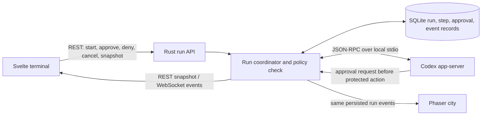

# The Grid Metropolis Harness — Verifiable Droid Runs

* **Author:** Project owner and Codex design draft
* **Status:** Final
* **Date:** 2026-10-29

## Overview

The Harness should let a user give a task to a selected project, watch the droids carry it through real execution and verification, and inspect what changed and why the run stopped. The existing Architect, Coder, and Reviewer roles provide the starting workflow. A configured test command and one bounded repair pass add evidence beyond model-written claims. The city uses recorded run events so visible task activity matches the run record.

## The Problem

The current Harness has a terminal, project conversations, a sequential multi-droid pipeline, a Codex streaming endpoint, and a separate Phaser city. These pieces do not yet provide one inspectable execution record. The pipeline can continue after a stage error and can report completion without independent test evidence. City agents can wander independently of actual work, and the Codex endpoint bypasses sandbox and approval controls while accepting a caller-provided working directory. As a result, users cannot tell what ran, what was authorized, whether tests passed, or whether a visible droid action represents real work.

The design connects the workflow to a server-owned run record, enforces the project and droid access rules before operations execute, records machine-verifiable test outcomes, and drives the terminal and city from those same events. If a required permission is denied, the droid may try up to three distinct alternatives within existing grants. If none works, it can make one specific new request; if that grant is denied, the run stops as blocked while preserving prior work.

## Goals

* Let the user start a real run in a selected project and inspect its current stage, responsible droid, operations, and outcome.
* Reuse the sequential Architect → Coder → Reviewer flow while recording stage failures and preventing success without verification evidence.
* Enforce project-level access limits and narrower per-droid permissions in the backend, including explicit access to any named reference projects.
* Pause before an operation that lacks permission. Keep the pending request across Harness restarts without keeping a process active, and resume only after the specific operation is authorized.
* After a denied action, allow up to three distinct alternatives using already granted access, followed by at most one specific permission request. If that request is denied, stop as blocked.
* Run an explicitly configured verification command, record its exit status and bounded output, and allow one repair pass before reporting the final result.
* Produce a factual run record and summary from captured operations, changed files, test evidence, and review findings.
* Show task-related droid activity in the terminal and city from the same run events. Label ambient or simulated activity so it cannot be mistaken for live execution.
* Preserve older project conversations and thread records while introducing versioned run state.

## Non-Goals

* A general-purpose workflow engine, parallel autonomous agents, or an open-ended repair loop.
* Unrestricted access to the host, arbitrary caller-supplied paths, or access to unlisted reference projects.
* Remembered permissions in the first safe milestone. They may be added after task-scoped grants are enforced, audited, and revocable.
* A mandatory documenter droid for every task; the first version can generate a factual summary from run evidence.
* Building a full city simulation, social behavior system, or elaborate animations before the real run flow is verified.
* Adding Redis, distributed queues, or a separate telemetry platform for the initial desktop workflow.

## Open Questions

* Which project script formats are supported for verification preset discovery, and how should the setup UI behave when it finds no script or several plausible scripts?
* Which local callers rely on the current `/api/v1/codex/stream` request/auth behavior, beyond the Svelte client in this repository? Authentication and path-validation migration requirements are defined under Decision 3.

## Technical Plan (Architecture)

### Decision 1: Codex execution interface — selected

The owner selected **Option A: Codex app-server over local stdio**. The Rust backend will start the app-server as a child process and exchange JSON-RPC messages over stdin/stdout. The app-server will remain local to the sidecar; do not expose its TCP WebSocket listener. The Codex documentation describes stdio as the default transport and marks the TCP WebSocket transport experimental and unsupported for production. [Codex App Server](https://learn.chatgpt.com/docs/app-server)

The Rust run coordinator remains the authority for project identity, droid policy, durable run status, and verification outcomes. Configure the app-server sandbox from the intersection of the project ceiling and droid profile so operations allowed without an approval prompt still remain inside the effective policy. Persist and inspect every approval request before answering it. The Phase 0 prototype must prove the policy boundary for both prompted and auto-allowed operations; disable any operation that cannot be mapped to the effective policy. Use only sandboxed operations; do not expose app-server methods that execute shell commands outside the sandbox. Start with the Codex-backed execution path; other configured model providers remain available for conversation but are not treated as project-changing runners until they have an equivalent controlled execution adapter.

The existing `codex exec --json` approach is retained as an alternative for fixed-policy batch runs, but its non-interactive mode does not provide the required in-app approval pause when an operation cannot surface a fresh approval. A Harness-owned model/tool loop is also an alternative, but it would mean maintaining a second agent runtime. Neither option is selected.

Persist the approval record independently of the app-server process. Recovery follows three cases: (1) no grant was sent, so keep the request visibly pending and, after resuming the thread, reissue the same operation in a new turn; show a new approval only when its canonical payload fingerprint matches the saved request; (2) a grant was sent but no completed result was persisted, so mark the run `BLOCKED` and never retry the possibly started operation; (3) a completed result was persisted, so continue from the next workflow stage without replay. If the resumed operation differs from the saved request, block it for operator review. The protocol documents thread resume and active approval request/response, but does not promise that an old JSON-RPC approval request can be reattached after process exit; treat reissuance as a new request. See [Codex App Server approvals](https://learn.chatgpt.com/docs/app-server#approvals) and [thread resume](https://learn.chatgpt.com/docs/app-server#start-or-resume-a-thread).

The current backend starts `codex exec --json` as a child process and streams JSON Lines through SSE. It disables the Codex sandbox and approval prompts. This run path cannot enforce the required permission boundary or pause at a permission request until that behavior changes.

The alternatives considered for this decision are:

#### Option A: Codex app-server over local stdio — selected

The Rust backend starts `codex app-server` as a child process and speaks its JSON-RPC protocol over stdin/stdout. The Harness maps its approval requests to durable run records and the permission UI, then responds to Codex. App-server supports streamed thread/turn events, approval requests, and thread resume. Use local stdio rather than its TCP WebSocket listener, which the current documentation marks experimental and unsupported for production use. See [Codex App Server](https://learn.chatgpt.com/docs/app-server).

* **Trade-off:** Exposes approval request and decision messages to a custom client, while requiring a long-lived JSON-RPC adapter and compatibility checks against the app-server protocol.
* **Acceptance condition:** Before enabling task execution, a prototype must prove that a pending operation can be safely resumed after the Harness and app-server restart without repeating prior file changes or commands.

#### Option B: Keep non-interactive `codex exec --json`

The backend continues to start one Codex CLI process per run step with explicit sandbox and approval settings. The run service records an approval-required failure as pending; after the user grants access, it resumes from a persisted checkpoint in a new CLI turn. `codex exec` is documented for automation with pre-set sandbox and approval settings and supports JSONL progress and session resume. If an action requiring new approval cannot surface an interactive request, the action fails back to the caller rather than waiting in the Harness. See [Non-interactive mode](https://learn.chatgpt.com/docs/non-interactive-mode) and [Agent approvals and security](https://learn.chatgpt.com/docs/agent-approvals-security).

* **Trade-off:** Reuses the current process and JSONL streaming shape, with less protocol integration than app-server. The Harness must own pause, checkpoint, and resume behavior rather than relying on an in-flight Codex approval.
* **Reason not selected:** It lacks the in-app approval pause required for this workflow unless the Harness builds its own checkpoint-and-restart mechanism around CLI failures; that would leave the core approval boundary outside Codex’s interactive protocol.

#### Option C: Harness-owned tool execution loop

The Harness asks the selected model for structured tool calls and runs each file, shell, test, or web operation through its own server-side tool adapter. The adapter checks project and droid policy before each operation and persists permission pauses itself.

* **Trade-off:** Gives the Harness direct control over permission scopes and pause/resume behavior across providers. It requires building and maintaining the agent loop, tool protocol, sandbox boundary, and provider adapters rather than relying on Codex’s execution harness.
* **Failure condition:** Do not select it if the supported tools cannot cover actual project work or if the team cannot maintain the additional model/provider adapters, tool protocol, sandbox boundary, and recovery logic.

### Decision 2: Live run events and reconnect recovery

The owner selected **Option A: existing WebSocket for run events, REST for commands and snapshots**.

The city and terminal need the same run updates, while a closed or disconnected client must recover without losing an approval request or terminal result. The backend will persist run state and event sequence numbers in SQLite; the client can then fetch the current run snapshot after reconnect. Choose how live updates reach the connected client:

#### Option A: Existing WebSocket for run events, REST for commands and snapshots

Keep REST calls for starting, approving, denying, and cancelling runs. Publish correlated run events over the existing `/ws` connection. On reconnect, fetch the persisted run snapshot, then consume new events.

* **Trade-off:** Uses the current channel used by the city and keeps client commands request/response. The WebSocket protocol needs a clear event cursor and snapshot reconciliation rule.
* **Failure condition:** Do not select it if the existing WebSocket cannot support durable event IDs or if reconnect can leave a gap that the REST snapshot cannot reconcile.

#### Option B: SSE stream per run, REST for commands and snapshots

Keep REST for run commands and state queries, and provide a run-specific SSE stream for ordered lifecycle updates. The client reconnects with a last-seen event ID, then fetches a snapshot if the event history has expired.

* **Trade-off:** Fits the unidirectional run event flow and existing SSE experience. It creates a second live-update path alongside the city WebSocket.
* **Failure condition:** Do not select it if the client needs bidirectional run control on the stream or if managing two reconnect/event paths causes inconsistent UI state.

#### Option C: One bidirectional WebSocket for run commands and events

Send run commands and receive run events over a run-aware WebSocket protocol, with a separate REST endpoint for initial snapshots and recovery.

* **Trade-off:** One live connection can carry commands and events together. The protocol must define request IDs, acknowledgements, authorization, reconnect replay, and idempotency for every command.
* **Failure condition:** Do not select it if lost acknowledgements can cause duplicate grants, task starts, or cancellations, or if the extra protocol complexity is not justified by the desktop client.

### Selected event flow

Use the existing WebSocket only for server-to-client run lifecycle events. Use authenticated REST requests for starting a run, responding to a permission request, cancelling a run, fetching the current snapshot, and minting a WebSocket ticket. Persist events before publishing them and include a monotonically increasing sequence number per run. On reconnect, the client fetches a snapshot and cursor, then opens a ticket-scoped subscription; the server attaches to live events before replaying from that cursor, so events committed during the handoff are either replayed or buffered live.

Every run event carries `run_id`, `project_id`, `droid_id` when relevant, `step_id`, `attempt`, `sequence`, `timestamp`, and a typed payload. The run coordinator—not the UI or game scene—owns transitions. The Svelte terminal and Phaser scene are projections of the same stored state. Animation failure cannot change a run result.

The Rust backend resolves `project_id` to the configured canonical root. Clients cannot select a filesystem path by sending `working_dir`. Run-control and execution routes use the existing `RequireAuth` Bearer middleware. Tauri creates a cryptographically random per-launch token, passes it to the sidecar as `BRIDGE_AUTH_TOKEN`, and exposes it to the WebView through a Tauri command; the WebView keeps it in memory and adds it to authenticated API calls. Remove the fixed-token fallback and fail closed if no token is configured. Browser development uses an explicitly configured development token that is never committed. All routes validate that a run and approval request belong to the referenced project. Permission responses use an approval-request ID and an idempotency key so retrying a lost HTTP response cannot grant or execute the operation twice.

### Decision 3: Run API resource paths

The owner selected **Option B: preserve the SSE endpoint and add a durable-run resource**. Keep `POST /api/v1/codex/stream` as an SSE contract for existing callers. Start workflow runs with `POST /api/v1/projects/{project_id}/runs`, return `202 Accepted` with a `run_id`, and use the selected REST + WebSocket design for run actions and updates. The Svelte client moves to the durable-run resource for orchestrated work.

Preserving the SSE response format does not mean preserving the current unrestricted behavior. All execution paths, including the legacy SSE route, must resolve registered project identity on the server and enforce sandbox, authentication, and capability policy. Any request or auth change that breaks existing callers must be documented in the OpenAPI contract and have a migration path.

No OpenAPI or Postman contract currently exists in the repository. Create one OpenAPI contract as the source of truth for the new durable-run API and any changed legacy SSE requirements before implementation. Keep the existing stream route’s response format unless a separate versioned change is approved.

The durable-run API will use these resource operations:

* `POST /api/v1/projects/{project_id}/runs` creates a run and returns `202 Accepted`, its stable `run_id`, initial state, and a `Location` for the run resource. A required idempotency key prevents duplicate run creation on client retry.
* `GET /api/v1/runs/{run_id}` returns the current durable snapshot, including project, stage, droid, pending permission request, evidence, and terminal outcome. The server verifies the caller’s project access.
* `GET /api/v1/runs/{run_id}/events?after_sequence=<n>` replays persisted events after the client’s last sequence number.
* `POST /api/v1/runs/{run_id}/permission-requests/{request_id}/decisions` records a one-time grant or denial. The server verifies the request is still pending and applies a repeated decision idempotently.
* `POST /api/v1/runs/{run_id}/cancellations` requests cancellation and returns the resulting or pending state.
* `POST /api/v1/ws/tickets` requires Bearer auth and creates a single-use, 60-second connection ticket scoped to the caller's project and allowed run subscriptions. The client presents it as a WebSocket subprotocol token, never in a URL. The server consumes it during upgrade and filters run events to its project scope.
* The existing WebSocket publishes persisted run events. The client first fetches a snapshot with its `last_sequence`, then opens the authorized WebSocket subscription from that cursor. The server attaches to the live broadcast before querying persisted events after the cursor, sends ordered replay and a replay-complete marker, then delivers buffered live events. The client deduplicates by `(run_id, sequence)` and requests replay on any sequence gap.

Run creation accepts a task prompt and optional title/context references, but no caller-supplied filesystem path, arbitrary shell command, or unregistered project/droid ID. The project’s selected verification preset and configured role sequence are resolved from server-owned settings. Run-control and Codex execution routes require local authentication. Use one stable JSON error envelope with machine-readable `code`, human-readable `message`, and a request ID; return distinct status codes for invalid input, unauthenticated, forbidden, unknown project/run, conflicting run state, and unavailable Codex runtime.

### Decision 4: Durable run record layout

The owner selected **Option A: normalized run, step, permission, and event tables**. Additive SQLite migrations create the tables without rewriting project conversations or droid records. Each state change that affects the run snapshot and event history commits in one transaction; publish the WebSocket event only after commit.

The backend already uses SQLite for projects and messages. Both designs below add run persistence to that database; neither holds a database lock while waiting for Codex or a verification command. The run record and its event must commit before the event is published to the WebSocket.

#### Option A: Normalized run, step, permission, and event tables

Add relational tables for `runs`, `run_steps`, `run_permission_requests`, and `run_events`, with foreign keys and a unique `(run_id, sequence)` event cursor. Store flexible provider and event details in JSON payload columns while keeping IDs, state, timestamps, and decisions in typed columns.

* **Trade-off:** Makes state transitions, pending approvals, and audit queries explicit and constrained. Requires more additive schema work and transaction logic.
* **Failure condition:** Do not select it if the run data is too transient to justify relational history or if the project cannot support safe additive schema changes.

#### Option B: Run snapshot plus append-only event table

Add a `runs` table with a JSON snapshot of current state and a separate append-only `run_events` table with sequence IDs. Each state transition updates the snapshot and appends its event in one transaction; step and approval details live inside the snapshot and event payloads.

* **Trade-off:** Keeps the schema smaller and supports reconnect replay while allowing the run shape to evolve. Application code must validate nested state and guard snapshot/event consistency.
* **Failure condition:** Do not select it if support, audit, or history views need frequent queries across individual steps or permission requests that JSON snapshots cannot answer safely and clearly.

### Decision 5: Project verification command configuration

The owner selected **Option A: select from detected project scripts and presets**. Project setup shows supported script names and stores a stable preset ID. The backend resolves the preset to a server-owned argument vector; the model cannot change or substitute it during a run.

The run needs a real command to verify changes. The command must be selected by project configuration, run under the project's sandbox and resource limits, and recorded with its exit status and bounded output. The model must not silently invent or substitute a verification command.

#### Option A: Select from detected project scripts and presets

The Harness detects supported project scripts (such as package scripts or Cargo test/build targets), shows the available names, and stores the selected command as a stable preset ID with a server-owned argument vector.

* **Trade-off:** The UI can present clear named choices and the server can control the exact executable and arguments. It will not cover every repository's custom verification workflow.
* **Failure condition:** Do not select it if supported project types or custom task-specific verification cannot be represented by the preset catalog.

#### Option B: Let the project owner configure an exact argument vector

The owner stores the executable and arguments for the project in settings. The server runs that exact array without shell interpolation, within the selected project root and sandbox. The agent may recommend a change, but cannot alter the configured command during a run.

* **Trade-off:** Supports custom verification while keeping command choice outside model control. Project setup requires the owner to know and maintain the correct command.
* **Failure condition:** Do not select it if supported platforms cannot execute or constrain the stored command safely, or if users need the model to select verification steps dynamically.

### Run coordinator boundaries and workflow

The Rust server owns the run state machine and is the only component allowed to make execution or permission decisions. Svelte requests a new run and renders persisted state. The Rust coordinator writes a run record, creates the Codex app-server thread, and advances the Architect → Coder → configured verification → at-most-one repair → Reviewer sequence. Every stage records a typed result; a failed stage prevents downstream success. A deterministic summary is generated from recorded operations and outcomes. A separate Documenter droid is out of scope for the first milestone.

The run state machine includes `QUEUED`, `PLANNING`, `EXECUTING`, `VERIFYING`, `REPAIRING`, `REVIEWING`, `WAITING_FOR_PERMISSION`, `SUCCEEDED`, `FAILED`, `BLOCKED`, and `CANCELLED`. Only a recorded verification success and all required stages can produce `SUCCEEDED`. After a permission denial, the droid may try up to three distinct alternatives using current grants; after that, it can make one specific additional permission request. If the user denies that request, the run becomes `BLOCKED`. Each attempt is recorded; the run never repeats an uncertain mutating action after restart. Each project must configure per-run ceilings for elapsed time, Harness-dispatched model turns, and tokens. Droid and run overrides may only lower the project ceilings. Reaching any effective ceiling stops further work and records `BUDGET_EXHAUSTED` as the terminal outcome.

Budget semantics: elapsed time is wall-clock seconds from run start; a model call is one `turn/start` dispatched by the Harness (not each internal model request); tokens are cumulative input plus output tokens reported by the provider. The coordinator reserves known/estimated usage before dispatch and reconciles provider-reported usage afterward. In the generated stable schema for app-server 0.164.0, `turn/start` has no `maxOutputTokens` field. `thread/tokenUsage/updated` supplies usage telemetry, but the probe observed it after dispatch. The owner approved a best-effort token budget on 2026-10-29: stop or interrupt further work once reported usage reaches the configured value and block the next turn; a single in-flight turn may exceed the value. The UI must disclose this possible overshoot. Harness-dispatched model-turn and elapsed-time ceilings remain hard limits. Tool invocations are not counted as model turns and remain subject to sandbox, verification timeout, and output limits.

The app-server adapter handles Codex threads, turns, streamed items, and approval requests over local stdio. The Rust policy service resolves the project root and droid profile from server-owned IDs. Before answering an app-server approval request, it checks the requested command, filesystem path, and network scope against the project ceiling and droid subset. The backend persists the pending action, then the client shows its exact target and consequence. A grant applies only to that displayed action. A denial returns control to the workflow so the droid can attempt its bounded alternative path.

Map the capability profile to Codex sandbox settings per turn: the project root is the working directory; droid-allowed write roots become `writableRoots`; explicitly selected reference projects are added only as restricted read-only roots; network is enabled only when both project and droid policy allow it. Keep web-search access separate from shell-command network access. App-server documents per-turn sandbox overrides, restricted read roots, and `command/exec` under the server sandbox. Do not expose `process/spawn`, which the current documentation marks experimental and outside the sandbox. See [Codex App Server sandbox policy](https://learn.chatgpt.com/docs/app-server#sandbox-read-access-readonlyaccess) and [command execution](https://learn.chatgpt.com/docs/app-server#command-execution).

Verification uses the selected project preset and app-server `command/exec` with a fixed argument vector, canonical project root, explicit timeout, and output limits. Persist command identity, exit code, duration, and bounded stdout/stderr. If verification fails, send the recorded evidence to the Coder for one repair attempt, then rerun the same preset once. No model-generated shell string is accepted as the verification command.

### Run persistence and event contract

The normalized SQLite design uses additive tables:

* `runs`: run ID, project ID, status, selected droid IDs, idempotency key, Codex thread reference, effective budget snapshot, timestamps, and terminal outcome.
* `run_steps`: run ID, stable step ID and order, droid ID, stage, attempt number, status, start/end time, and structured result reference.
* `run_permission_requests`: request ID, run/project/droid IDs, requested action and resource, requested capability, pending/granted/denied status, app-server thread/turn/item/request IDs, canonical payload fingerprint, response-sent state, and decision timestamps.
* `run_events`: run ID, unique sequence number, typed event name, timestamp, and bounded, redacted JSON payload for WebSocket replay.

Create the appropriate foreign keys and indexes; project deletion must not silently erase an active run or its audit history. Store payloads without credentials or private model reasoning, and bound and redact captured command output before persistence. A pending approval record survives in SQLite, but the app-server's original JSON-RPC approval request is not assumed to survive process exit. Persist the Harness-owned permission request ID, app-server process generation, thread/turn/item IDs, connection-scoped JSON-RPC request ID, any app-server approval ID, exact request payload, canonical payload fingerprint, and whether a decision was sent. Do not use a raw JSON-RPC request ID as a globally unique or durable key: the Phase 0 probe observed ID `0` on separate app-server processes. On restart, resume the stored thread and inspect persisted item history: if no grant was sent, keep the request pending and reissue the same operation in a new turn, showing a new approval only when the fingerprint matches; if a grant was sent or an operation may have started without a persisted completed result, mark the run `BLOCKED` and do not retry; if the completed result was persisted, continue from the next stage. A fingerprint mismatch is `BLOCKED`. This follows the documented distinction between `thread/resume` (resume a stored thread for later turns) and the active approval request/response flow; the protocol does not promise reattachment to the old request. See [App Server thread resume](https://learn.chatgpt.com/docs/app-server#start-or-resume-a-thread) and [approval requests](https://learn.chatgpt.com/docs/app-server#approvals).

The run API source of truth is one OpenAPI file at `server/openapi.yaml`. It defines the durable-run start, snapshot, permission-decision, cancellation, event-replay, execution-settings, verification-preset, and WebSocket-ticket contracts, including auth, idempotency, stable errors, and success/failure examples. Keep the legacy `/api/v1/codex/stream` SSE response envelope for existing callers, but resolve `working_dir` only to an already registered canonical project; reject unregistered paths and enforce the same server-side limits. The new Svelte workflow uses the durable-run resource and does not use the legacy stream endpoint for orchestration.

Persist lifecycle events before broadcasting them over `/ws`. Each event has a per-run increasing sequence number and includes run, project, step, droid, attempt, and timestamp fields. After obtaining an authenticated ticket, the client subscribes to `/ws` with the snapshot's last sequence. The server attaches to the live channel before replaying persisted events from that cursor, sends an ordered replay and replay-complete marker, then delivers buffered live events. Clients deduplicate and request REST replay on sequence gaps. Svelte stores and Phaser both render this canonical event stream. Ambient or simulated activity is labeled separately; animation errors do not affect task status.

### Run and API contracts

The OpenAPI contract and SQLite records use these typed fields and constraints:

* `ProjectExecutionSettings`: required project ceilings `max_model_turns_per_run`, `max_elapsed_seconds_per_run`, and `max_tokens_per_run`; each droid profile and run may specify lower values but cannot raise the project ceiling. Reject run start with `422 EXECUTION_BUDGETS_REQUIRED` until all three project values are configured. No numeric defaults or product-wide hard maxima are selected in this design.
* `Run`: `run_id`, `project_id`, ordered `droid_ids`, `status`, `idempotency_key`, `task_title`, `prompt`, selected `verification_preset_id`, effective `policy_snapshot`, immutable effective budget snapshot and current usage counters, nullable Codex `thread_id`, creation/update/completion timestamps, and terminal outcome. Freeze the budget snapshot at run start; project setting changes apply to future runs. Enforce unique `(project_id, idempotency_key)`. A repeated start with an identical request returns the existing run; a different request with that key returns `409 IDEMPOTENCY_CONFLICT`.
* `RunStep`: `step_id`, `run_id`, ordinal, stage, `droid_id`, attempt number, status, start/end timestamps, bounded result summary, and optional verification evidence. Enforce unique `(run_id, ordinal, attempt)`.
* `RunPermissionRequest`: Harness request/run/project/step/droid IDs, capability, exact action/resource, rationale, pending/granted/denied status, alternative index, creation/decision timestamps, one-time grant scope, app-server process generation and thread/turn/item IDs, connection-scoped JSON-RPC request ID, optional app-server approval ID, exact payload fingerprint, and whether a response was sent/resolved. A decision is immutable; repeating the same decision is idempotent and a conflicting decision returns `409 DECISION_CONFLICT`.
* `RunEvent`: `run_id`, per-run `sequence`, typed event name, timestamp, project/droid/step IDs when applicable, attempt, and bounded redacted JSON payload. Enforce unique `(run_id, sequence)` and append the event in the same transaction as its state change.

Allowed transitions are `QUEUED → PLANNING → EXECUTING → VERIFYING`; failed verification may transition once through `REPAIRING → VERIFYING`; successful verification transitions to `REVIEWING → SUCCEEDED`. Any active state may transition to `WAITING_FOR_PERMISSION` or `CANCELLED`; runtime or required-stage errors transition to `FAILED`; denial of the final specific request, unrecoverable/uncertain restart, a request outside project policy, or exhausted budget transitions to `BLOCKED`. Budget exhaustion sets terminal outcome `BUDGET_EXHAUSTED`. Terminal states have no outgoing transitions. The first three denied-action alternatives must be distinct, within current effective policy, and recorded. If all fail, the coordinator may issue one specific request; denial blocks the run. A task-scoped grant may add the exact operation to the droid's effective access for that run only, but never exceed the project ceiling. An operation outside the project ceiling cannot be granted in the permission panel; the operator must explicitly change project settings first.

Run start returns `202` with the initial snapshot, `run_id`, and `Location`. Snapshot and replay responses include the latest sequence cursor. `POST /api/v1/ws/tickets` accepts `project_id` and selected `run_ids` and returns an opaque ticket, scope, and expiry; tickets expire after 60 seconds and are consumed once during the WebSocket upgrade. Permission decisions require an `Idempotency-Key`; cancellation is idempotent. Errors use `{code, message, requestId}` with `400 VALIDATION_ERROR`, `401 UNAUTHENTICATED`, `403 FORBIDDEN`, `404 NOT_FOUND`, `409` for run/decision/idempotency conflicts, `422 EXECUTION_BUDGETS_REQUIRED` when project ceilings are missing, `422 EXECUTION_BUDGET_EXCEEDS_PROJECT_LIMIT` when a droid/run override raises a ceiling, and `503 RUNTIME_UNAVAILABLE`. Event replay is ordered, exclusive of `after_sequence`, and returns `next_sequence` and `has_more`. Project deletion is rejected while a nonterminal run exists and requires explicit archive/purge confirmation for retained run history.

## Risks & Mitigations

* **Unauthorized or out-of-scope execution:** enforce canonical project roots, droid subsets, project ceilings, task-scoped grants, and Codex sandbox policy at every execution boundary; disable any operation that cannot be mapped to effective policy.
* **False success:** require recorded verification exit status and required review completion before `SUCCEEDED`.
* **Repeated side effects after restart:** resume only when persisted protocol evidence proves the operation did not complete; otherwise set `BLOCKED` and require operator recovery.
* **Missed or exposed run events:** authenticate WebSocket subscriptions, filter by project, persist before broadcast, close the replay/live handoff gap, and deduplicate by sequence.
* **Runaway cost or sensitive output:** require project-configured model-turn/time/token budgets, allow droid/run overrides only to tighten them, redact and bound output, and distinguish provider-reported usage from estimates. The current app-server schema exposes post-dispatch token telemetry but no per-turn maximum-output field; strict token enforcement is not proven and blocks real-run enablement until the owner accepts a best-effort budget or an enforceable alternative is found.
* **Legacy data loss:** use additive, ordered SQLite migrations and test upgrades of existing project/conversation data before enabling the feature.
* **Misleading city activity:** derive task animation from persisted run events and label ambient behavior as simulated.

## Alternatives Considered

The selected mechanisms and full trade-offs are specified under Decisions 1–5. This list records only the rejected direction and its decisive reason.

* **One droid only:** simpler orchestration, but removes the existing Architect → Coder → Reviewer handoffs; retain as a fallback if the three-role flow cannot be made safe.
* **Parallel configurable workflows and open-ended retries:** adds concurrency and recovery states before a safe sequential run has been proven; defer.
* **Mandatory Documenter:** adds model cost and can state outcomes unsupported by evidence; generate deterministic summaries and add a documenter only for a concrete artifact.
* **Remembered grants:** reduce repeated prompts but require persistent scope, audit, and revocation; start with task-scoped grants.
* **Redis, a queue, or telemetry platform:** adds operational and recovery burden to the local desktop workflow; start with SQLite, existing tracing, and persisted events.
* **Non-interactive `codex exec`:** does not provide the required in-app approval pause; use app-server only after restart recovery is proven (Decision 1).
* **Harness-owned model/tool runtime:** enables cross-provider control but requires maintaining provider adapters, sandboxing, and recovery; defer (Decision 1).
* **Per-run SSE or replacing/versioning the legacy stream:** adds another event path or risks existing callers; use REST plus the city WebSocket for durable runs and preserve the legacy SSE response (Decisions 2–3).
* **JSON-only run snapshot:** makes step and approval queries depend on application parsing; use normalized records (Decision 4).
* **Free-form verification commands:** are harder to constrain than server-owned argument vectors; use detected presets (Decision 5).

## Detailed Implementation

This section turns the approved architecture into a reviewable implementation sequence. The paths below follow the current repository layout; new files are marked **Create**. This is a design plan only and does not authorize implementation by itself.

### Phase 0 — Resolve execution and policy prerequisites

1. Prototype `codex app-server` over local stdio against a disposable project. Exercise the three recovery cases: (a) no approval grant was sent—the persisted request remains visibly pending, resume the thread, reissue the same operation, and create a fresh approval only for a matching fingerprint; (b) a grant was sent but no completed result was persisted—recover as `BLOCKED` and prove no retry occurs; (c) a completed result was persisted—advance to the next stage without replay. Also verify uncertain mutation becomes `BLOCKED` and a finished turn remains terminal. Record protocol IDs, persisted state, and filesystem/command evidence. Verify what usage information and pre-dispatch token limits app-server exposes; document any gap and keep real runs disabled if the coordinator cannot enforce the configured ceilings safely.
2. Define the supported verification preset discovery list from project metadata (initially Node package scripts and Rust Cargo commands). Store the selected preset ID, not a command string. If discovery finds zero or multiple candidates, require explicit selection or leave verification unconfigured; the run must not claim success without a selected preset.
3. Inventory existing `/api/v1/codex/stream` callers. Reuse `RequireAuth` Bearer validation; remove its fixed-token fallback. Tauri generates a cryptographically random 256-bit per-launch token, passes it to the sidecar as `BRIDGE_AUTH_TOKEN`, and provides it to the WebView through a registered Tauri command. Keep the token in WebView memory only. Browser development requires an explicit uncommitted `BRIDGE_AUTH_TOKEN`. If an existing backend is detected without a matching token, disable protected run operations rather than treating it as authenticated. Missing tokens fail closed with `401`; no execution runs before this path is available. Require all three project budget ceilings before a run can start; no preset numeric values are imposed by the product.

Current Phase 0 evidence is recorded in [the app-server spike report](harness-pro-phase0-report.md). The local probe confirmed thread resumption, fresh approval reissuance with a matching fingerprint, conservative `BLOCKED` recovery after a sent grant without a Harness-persisted result, and continuation from a persisted completed item. It also confirmed that JSON-RPC request IDs can repeat between processes. These results validate the protocol path, not a production Rust recovery coordinator. The owner accepted best-effort token budgets; strict per-turn token ceilings are unsupported by the current app-server schema, so the coordinator and UI must expose and enforce the approved stop-on-observed-usage behavior.

### Phase 1 — Backend run domain, storage, and policy

| File | Change | Reason |
| --- | --- | --- |
| **Create** `server/src/domain/run.rs` | Define run, step, status, permission request/decision, verification evidence, event, and terminal outcome types; encode allowed state transitions. | Keep lifecycle invariants independent from HTTP, SQLite, and Codex transport. |
| `server/src/domain/mod.rs` | Export the run domain types. | Integrate the run model with existing domain modules. |
| **Create** `server/src/run/mod.rs` and `server/src/run/coordinator.rs` | Implement sequential Architect → Coder → verification → at-most-one repair and verification rerun → Reviewer orchestration, the stated alternative rules, cancellation, and evidence-based terminal outcomes. | Move authority out of the client store and keep failures from advancing stages. |
| **Create** `server/src/run/policy.rs` | Resolve project-level capability ceilings and droid-level subsets; validate filesystem, reference-project, web-search, shell-network, and command requests. | Enforce the same policy at every server execution boundary. |
| **Create** `server/src/security/mod.rs` and `server/src/security/project_paths.rs` | Expose a canonical project-root resolver and path-containment check shared by project file reads and run execution. | Replace the existing inline-only canonicalization with one reusable boundary check. |
| **Create** `server/src/run/budget.rs` | Enforce per-run model-call, elapsed-time, and token ceilings before each call; distinguish provider-reported token use from estimates and stop before a call that exceeds the remaining budget. | Enforce the owner-configured ceilings before another model call can start. |
| **Create** `server/src/run/codex_app_server.rs` | Spawn and supervise local `codex app-server`, frame JSON-RPC on stdio, translate thread/turn/item and approval messages, and reconcile persisted thread state at startup. | Isolate the provider protocol and make resume safety auditable. |
| **Create** `server/src/run/verification.rs` | Resolve a selected preset ID to a server-owned argv, run it under the project sandbox with timeout/output bounds, and capture exit code and duration. | Prevent model-generated commands from becoming verification commands. |
| `server/src/lib.rs` and `server/src/main.rs` | Register run/security modules, require `BRIDGE_AUTH_TOKEN`, initialize recovery before accepting new run requests, and share the coordinator and database with routes and WebSocket handling. | Ensure interrupted runs are reconciled before new work starts and unauthenticated execution is unavailable. |
| `server/src/db/sqlite.rs` | Use `PRAGMA user_version` for ordered additive migrations. Apply each version in its own SQLite transaction; preserve existing project, droid, message, and thread rows; add `runs`, `run_steps`, `run_permission_requests`, `run_events`, and typed execution-policy/preset settings. Update state and append its event atomically. | Make run state, settings, and audit history durable without rewriting project conversations. |
| `server/src/db/models.rs` and `server/src/db/mod.rs` | Add typed persistence records and expose run repository operations. | Keep SQL row mapping separate from run policy and orchestration. |
| **Create** `server/src/run/recovery.rs` | On startup, inspect nonterminal runs, reconcile app-server thread/operation state, resume only when safe, and otherwise mark the run `BLOCKED` with a recovery reason. | Prevent duplicate mutations after uncertain shutdowns. |
| **Create** `server/src/run/tests.rs` and `server/tests/e2e_runs_test.rs` | Cover run transitions, policy, budgets, migrations, authenticated endpoints, event replay, permissions, and recovery with explicit expected outcomes. | Make the release gates executable and repeatable. |
| `server/Cargo.toml` | Add only dependencies needed for app-server JSON-RPC framing and process supervision. | Support the adapter without introducing a general workflow runtime. |

The project permission ceiling and each droid's narrower profile are persisted in typed project/droid policy tables. The first version has no remembered grants. A one-time task grant may add only the displayed operation to the droid's effective access for that run and cannot exceed the project ceiling. Every permission request displays its exact action/resource. After denial, the coordinator records up to three distinct permitted alternatives; if those fail, it may issue one specific request. A second denial ends in `BLOCKED`. The coordinator chooses alternatives from operations supported by the current adapter and allowed by policy; if none exists, it skips directly to the one specific request, then blocks on denial.

### Phase 2 — Durable API and event delivery

| File | Change | Reason |
| --- | --- | --- |
| **Create** `server/src/api/runs.rs` | Implement run start, snapshot, event replay, permission decision, and cancellation handlers with project/run ownership checks, idempotency, and stable error envelopes. | Expose durable run control without changing the legacy SSE response format. |
| `server/src/api/mod.rs` | Register authenticated routes for run start/snapshot/replay/decision/cancellation, project execution-settings and preset discovery, and `POST /api/v1/ws/tickets`. Keep the WebSocket upgrade scoped to the validated ticket. | Keep route-level auth and contract paths aligned with OpenAPI. |
| `server/src/api/projects.rs` | Reuse project lookup and canonical-root validation for `GET/PUT /api/v1/projects/{project_id}/execution-settings` and `GET /api/v1/projects/{project_id}/verification-presets`; preset discovery returns stable IDs and labels, never executable client-supplied argv. | Let the operator configure project ceilings, droid subsets, references, and preset selection through authenticated project-scoped APIs. |
| `server/src/api/auth.rs` | Keep Bearer validation through `RequireAuth`, but remove the fixed fallback and reject startup or requests when `BRIDGE_AUTH_TOKEN` is absent. | Prevent the shipped fallback token from authorizing local execution. |
| `server/src/api/ws.rs` and `server/src/state/world.rs` | Add single-use 60-second tickets scoped to project subscriptions; authenticate upgrade, subscribe before replay, filter run events by scope, and send replay/high-water markers. | Protect private run events and close the replay/live delivery gap. |
| `server/src/api/codex.rs` | Keep `/api/v1/codex/stream` SSE framing, but remove the bypass flags, reject arbitrary/unregistered working directories, and enforce authentication and the same policy boundary. | Preserve response compatibility while closing its unsafe execution path. |
| `server/src/api/error.rs` | Extend the API error model to the documented machine-readable code, message, and request ID envelope for new run operations. | Give the UI stable error handling across lifecycle commands. |
| **Create** `server/openapi.yaml` | Specify durable-run operations, project execution-settings, preset discovery, WebSocket-ticket exchange, auth, idempotency headers, request/response schemas, event payloads, error codes, replay handoff, and legacy SSE compatibility constraints. | Establish one reviewable API contract before client integration. |

Resolve every project, droid, run, and reference ID through server-owned records; never trust a client path or executable command. Commit the run transition and event together before broadcast. The WebSocket subscribes before replaying from the client's cursor; the detailed handoff and response fields are defined above.

### Phase 3 — Client run controls and verifiable terminal

| File | Change | Reason |
| --- | --- | --- |
| **Create** `client/src/lib/stores/runStore.ts` | Own run creation, snapshot/replay recovery, event cursor, pending permission, cancellation, and displayed outcome. | Replace optimistic local orchestration with a projection of backend state. |
| `client/src/lib/stores/projectStore.ts` | Retain project selection, conversations, and message history; route new task submission to run creation rather than invoking each droid sequentially in the browser. | Separate durable workflow state from project chat state. |
| `client/src/lib/ai/aiService.ts` | Keep conversational streaming where applicable; remove it from project-changing run execution and stop sending caller-selected `working_dir` for those runs. | Ensure actual execution goes through the run coordinator. |
| `client/src/lib/socket/client.ts` | Obtain a ticket, subscribe before snapshot/replay, buffer live events during reconciliation, deduplicate by sequence, and request replay on gaps. | Share the existing WebSocket without losing events or exposing run data across projects. |
| `client/src/lib/api.ts` and **Create** `client/src/lib/tauriAuth.ts` | Add typed helpers for authenticated run/settings/ticket calls; retrieve the per-launch token from Tauri and keep it in memory. | Give the WebView a local credential without storing it in localStorage or URLs. |
| `client/src/components/terminal/CrtTerminal.svelte`, `PipelineStepper.svelte`, and `ExecutionInspector.svelte` | Display durable stage, responsible droid, verification evidence, modified files, terminal result, and recovery state. Render success only when the server reports `SUCCEEDED`. | Make terminal claims traceable to run evidence. |
| **Create** `client/src/components/terminal/PermissionRequestPanel.svelte` | Show the exact pending action, target/resource, rationale, available grant/deny choice, and current alternative-attempt count; submit an idempotent decision. | Make permission pauses visible and actionable. |
| **Create** `client/src/components/terminal/RunHistory.svelte` | List a project's persisted runs and reopen their snapshots. | Let the user inspect runs after navigation or application restart. |
| **Create** `client/src/components/terminal/ProjectExecutionSettings.svelte` | Configure the project-wide capability ceiling, each droid's narrower subset, explicitly selected read-only reference projects, verification preset, and required per-run call/time/token ceilings; show inherited versus tightened droid/run budgets. Disable run start until all project ceilings are configured. | Expose the approved policy model and cost controls without conflating execution policy with model-provider preferences in `AiSettingsModal.svelte`. |

The first milestone keeps the existing Architect → Coder → Reviewer sequence and the terminal's conversation history. It removes the browser's authority to advance stages or declare completion. Private model reasoning is not persisted or shown as evidence; the inspector presents concise operation summaries and captured results instead.

### Phase 4 — City projection, configuration, and operator documentation

| File | Change | Reason |
| --- | --- | --- |
| `client/src/lib/game/gameBridge.ts` and `client/src/lib/game/scenes/MainIsometricScene.ts` | Subscribe to canonical run projections; move/animate droids only in response to run events. Keep unrelated ambient movement marked as simulated. | Make visible work correspond to the same run state shown in the terminal. |
| `client/src/lib/game/agents/AgentManager.ts` and `client/src/lib/game/agents/AgentEntity.ts` | Add idempotent visual handlers for working, handoff, waiting-for-permission, success, failure, blocked, and cancelled states. | Prevent duplicated or stale events from creating misleading city activity. |
| `client/src/types/index.ts` | Add typed run lifecycle event and snapshot contracts corresponding to OpenAPI. | Keep Svelte, WebSocket, and Phaser payloads aligned. |
| `server/README.md` and `client/README.md` | Document local authentication, app-server prerequisite, project registration, supported preset discovery, recovery limitation, and how to read run evidence. | Make the first end-to-end workflow operable and its limits explicit. |
| `client/src-tauri/src/lib.rs` and `client/src-tauri/Cargo.toml` | Generate a per-launch 256-bit token, pass it to the server sidecar, expose it through a registered Tauri command, and add `getrandom` if no equivalent cryptographic random source is already available. Register the command with Tauri's invoke handler. | Authenticate the local WebView to the sidecar without a fixed credential. |

### Acceptance and verification plan

The implementation must add unit coverage in `server/src/run/tests.rs` and API integration coverage in `server/tests/e2e_runs_test.rs`. The integration journey registers/selects a project, sets policy and preset, starts a run, observes Architect → Coder → Reviewer, handles a permission grant or denial, verifies, allows one repair and rerun, and checks that the final summary matches changed files and command evidence. Ambient droid activity must remain distinguishable from run-assigned activity.

Required assertions:

* A one-time grant permits only its displayed operation, may exceed the droid subset for that run only, and never exceeds the project ceiling; denial runs at most three distinct alternatives and one specific re-request.
* An operation already allowed by the sandbox remains within effective policy without an approval event; an unmappable operation is unavailable.
* Denying the final request yields `BLOCKED`; runtime/stage failures never yield `SUCCEEDED`; cancellation and terminal states persist.
* Repeating run start or a permission decision with the same idempotency key does not duplicate work; a conflicting payload/decision returns the specified `409`.
* An authenticated client receives only authorized project events. Snapshot plus subscribe/replay recovers an event committed during reconnect; duplicates are ignored by sequence.
* Project budgets are required before run start; droid/run overrides can only tighten them; usage counters and `BUDGET_EXHAUSTED` outcomes persist. Turn/time limits stop work before the next turn; token telemetry that reaches its configured best-effort ceiling interrupts or stops further work and is clearly labeled as possibly overshooting within the current turn.
* Migration from the current database preserves projects, droids, messages, and thread IDs. Redaction and output limits are enforced before persistence.
* App-server restart tests follow the three recovery cases: ungranted request remains pending and is reissued only with a matching fingerprint; grant sent without a persisted result becomes `BLOCKED` with no retry; persisted completion continues without replay. Uncertain mutation becomes `BLOCKED`; finished run remains terminal.

Real execution remains disabled until the durable coordinator, project budget settings, approval recovery, authenticated API, and end-to-end UI are implemented and verified. The UI must disclose that the accepted token budget is best-effort and can be exceeded by an in-flight turn.

### Implementation progress — execution settings API (2026-10-29)

The first API slice persists project budgets in SQLite and exposes authenticated `GET`/`PUT /api/v1/projects/{id}/execution-settings`. It fails closed with `503 AUTH_NOT_CONFIGURED` when `BRIDGE_AUTH_TOKEN` is missing or blank; invalid credentials receive `401`. The response distinguishes an unset budget from configured values, and errors include a stable machine code, message, and request ID. The contract is recorded in `server/openapi.yaml`.

This slice does not start or resume runs and does not enable real execution. Coordinator persistence/recovery, app-server integration, Tauri token delivery, and the UI flow remain required before that gate can change.

### File change summary

* **Create:** `server/src/domain/run.rs`, `server/src/run/{mod,coordinator,policy,budget,codex_app_server,verification,recovery,tests}.rs`, `server/src/security/{mod,project_paths}.rs`, `server/src/api/runs.rs`, `server/openapi.yaml`, `server/tests/e2e_runs_test.rs`, `client/src/lib/stores/runStore.ts`, `client/src/lib/tauriAuth.ts`, `client/src/components/terminal/{PermissionRequestPanel,RunHistory,ProjectExecutionSettings}.svelte`.
* **Modify:** server module registration, API routing/auth/errors/project settings/WebSocket, Codex stream safety, SQLite schema/repository, and server dependencies; Tauri sidecar token setup and invoke handler; client project submission, AI service boundary, API/socket helpers, terminal components, shared event types, Phaser bridge/scene/agent projection, and server/client READMEs.
* **Delete:** none in the first milestone. Remove obsolete client-side orchestration only after the durable-run client is wired and the legacy SSE consumer inventory is complete.

